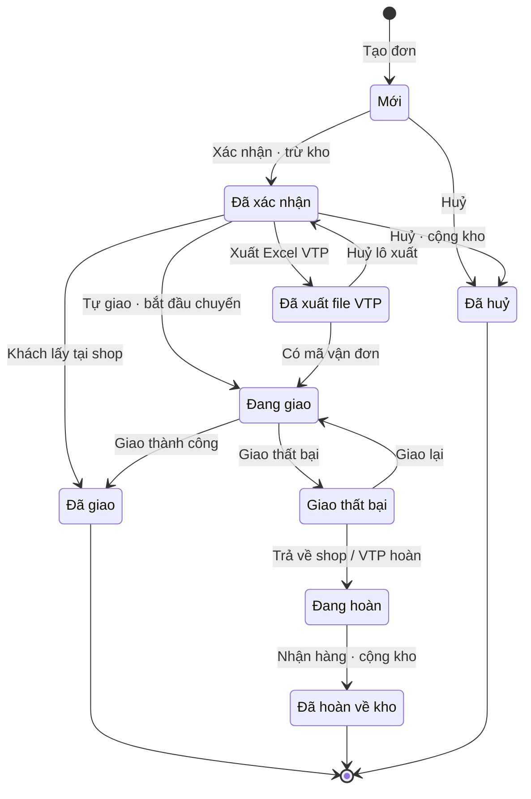
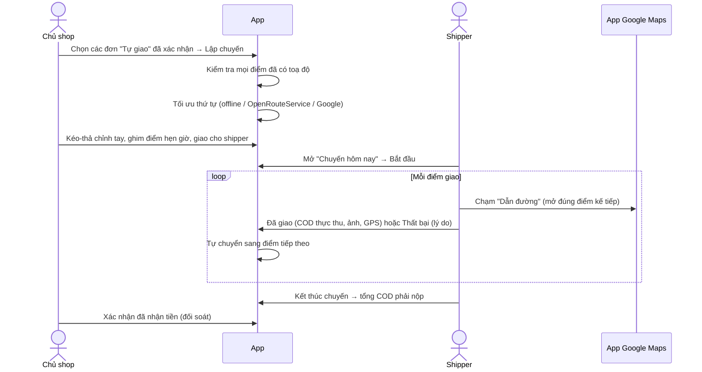
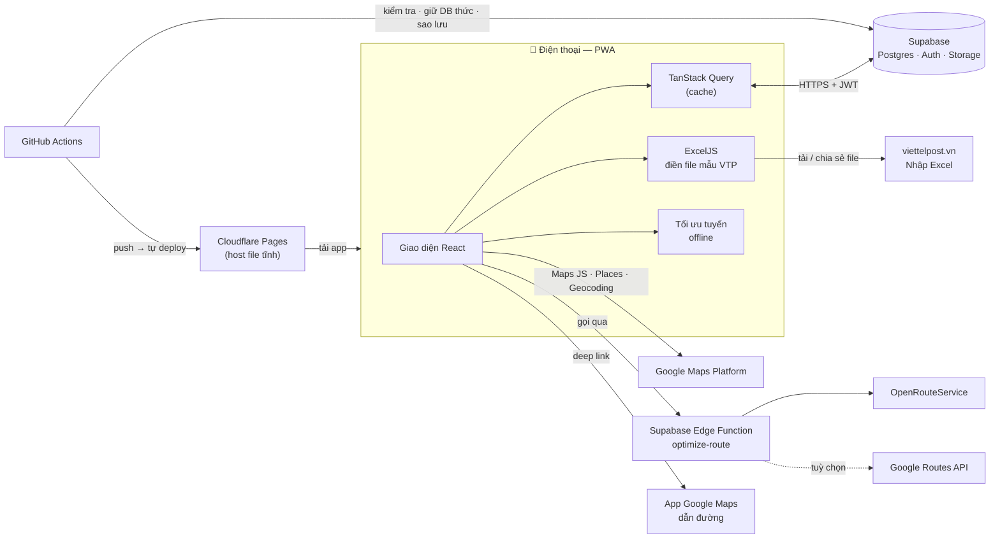
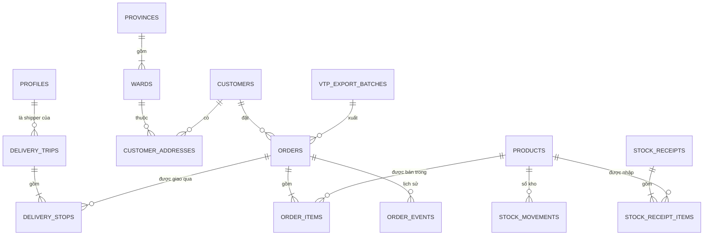

# Smart Delivery — Kế hoạch phát triển

> Ứng dụng cá nhân để quản lý **đơn hàng**, **kho**, **khách hàng**; giúp **shipper sắp xếp tuyến giao** và dẫn đường bằng Google Maps; **xuất file Excel để tạo đơn hàng loạt trên ViettelPost**.
> Ưu tiên giao diện **điện thoại**. Ít người dùng. **Toàn bộ hạ tầng miễn phí (0đ/tháng).**

| | |
|---|---|
| Phiên bản | 0.1 — bản nháp chờ duyệt |
| Ngày | 13/11/2026 |
| Trạng thái | Chưa code. Cần chủ dự án trả lời các câu hỏi ở [mục 11](#11-việc-cần-bạn-xác-nhận-trước-khi-code) |

---

## Mục lục

1. [Mục tiêu & phạm vi](#1-mục-tiêu--phạm-vi)
2. [Tính năng chi tiết](#2-tính-năng-chi-tiết)
3. [Kiến trúc & công nghệ](#3-kiến-trúc--công-nghệ)
4. [Thiết kế dữ liệu](#4-thiết-kế-dữ-liệu)
5. [Thiết kế giao diện điện thoại](#5-thiết-kế-giao-diện-điện-thoại)
6. [Lộ trình triển khai](#6-lộ-trình-triển-khai)
7. [Kiểm thử](#7-kiểm-thử)
8. [Bảo mật, dữ liệu cá nhân & sao lưu](#8-bảo-mật-dữ-liệu-cá-nhân--sao-lưu)
9. [Rủi ro & phương án](#9-rủi-ro--phương-án)
10. [Hướng mở rộng](#10-hướng-mở-rộng)
11. [Việc cần bạn xác nhận trước khi code](#11-việc-cần-bạn-xác-nhận-trước-khi-code)
12. [Tài liệu tham khảo](#12-tài-liệu-tham-khảo)

---

## 1. Mục tiêu & phạm vi

### 1.1 Mục tiêu đo được

| # | Mục tiêu | Tiêu chí |
|---|---|---|
| G1 | Tạo đơn nhanh trên điện thoại | Khách cũ: < 30 giây. Khách mới (dán tin nhắn): < 60 giây |
| G2 | Tồn kho luôn đúng | Mọi thay đổi tồn đi qua sổ nhập–xuất, truy vết được từng dòng; không lệch khi huỷ/hoàn |
| G3 | Xuất Excel ViettelPost dùng được ngay | File tải lên VTP không có dòng lỗi do sai định dạng |
| G4 | Shipper giao theo tuyến tối ưu | Danh sách điểm đã sắp thứ tự; 1 chạm mở Google Maps dẫn đường tới điểm kế tiếp |
| G5 | Chi phí 0đ | Không có khoản thu phí nào phát sinh ở bất kỳ dịch vụ nào |

### 1.2 Người dùng & vai trò

| Vai trò | Số lượng | Quyền |
|---|---|---|
| **Chủ shop** (owner) | 1–2 | Toàn quyền: sản phẩm, kho, khách, đơn, xuất VTP, lập chuyến, báo cáo, cài đặt |
| **Shipper** | 0–3 | Chỉ xem các chuyến được giao cho mình: tên, SĐT, địa chỉ, tiền COD, ghi chú. Cập nhật kết quả giao, ghi nhận tiền thu. **Không** thấy giá vốn, doanh thu, khách khác |

### 1.3 Quy mô giả định (để chọn hạ tầng)

≤ 100 đơn/ngày · ≤ 2.000 mã sản phẩm (SKU) · ≤ 10.000 khách · ≤ 5 tài khoản.
Với quy mô này, cơ sở dữ liệu tăng chưa tới 50 MB/năm, nằm thoải mái trong mọi gói miễn phí.

### 1.4 Ngoài phạm vi (giai đoạn đầu)

- **Không làm app native lên store**: Apple Developer tốn 99 USD/năm, Google Play 25 USD — trái tiêu chí miễn phí. Thay vào đó dùng **PWA** (web app cài được lên màn hình chính, chạy toàn màn hình như app thật).
- Không đồng bộ với sàn TMĐT (Shopee, TikTok Shop…), không kế toán / hoá đơn điện tử.
- Chưa gọi API ViettelPost ở bản đầu (để ở [mục 10](#10-hướng-mở-rộng)).

---

## 2. Tính năng chi tiết

Chia thành 6 module. Mã module (M1–M6) dùng trong lộ trình ở mục 6.

### M1 — Sản phẩm & Kho

**Danh mục sản phẩm**
- Trường: SKU, tên, ảnh, nhóm, đơn vị, giá bán, giá vốn, **khối lượng (gram, bắt buộc** — ViettelPost cần), kích thước D×R×C (tuỳ chọn), mã vạch, ngưỡng cảnh báo tồn, đang bán/ngừng bán.
- Biến thể (màu/size): mỗi biến thể là 1 SKU riêng, gom bằng trường `nhóm` để hiển thị gọn.
- Tìm kiếm **không dấu** ("ao thun" khớp "Áo thun"), lọc: nhóm, sắp hết hàng, ngừng bán.

**Nghiệp vụ kho**
- **Phiếu nhập kho**: nhiều SKU một lúc, số lượng, giá nhập, nhà cung cấp, ghi chú.
- **Kiểm kho**: nhập số đếm thực tế, app tự tạo phiếu điều chỉnh phần chênh lệch.
- **Thẻ kho** từng SKU: lịch sử nhập / xuất theo đơn / huỷ / hoàn / điều chỉnh, kèm tồn sau mỗi giao dịch.
- **Cảnh báo sắp hết hàng** trên màn Tổng quan.

**Quy tắc tồn kho**
- Tồn được tính từ sổ nhập–xuất (`stock_movements`); cột `stock_qty` trên sản phẩm chỉ là bản cache, cập nhật trong cùng transaction.
- **Trừ kho khi xác nhận đơn**, cộng lại khi huỷ đơn đã xác nhận hoặc khi nhận lại hàng hoàn. Đề xuất mặc định này, chờ bạn chốt ([mục 11](#11-việc-cần-bạn-xác-nhận-trước-khi-code)).
- Mặc định chặn xác nhận khi tồn không đủ; có công tắc trong Cài đặt cho phép âm kho (hàng đặt trước).

### M2 — Khách hàng

**Hồ sơ khách**
- Tên, SĐT (duy nhất, chuẩn hoá về dạng `0xxxxxxxxx`), SĐT phụ, nhãn (VIP, Khách sỉ, Hay hoàn hàng…), ghi chú.
- Nhiều địa chỉ / khách, 1 địa chỉ mặc định.
- Thống kê: số đơn, tổng chi, **tỉ lệ giao thành công / hoàn hàng**. Khi tạo đơn cho khách hay hoàn hàng, app hiện cảnh báo.
- Chạm để gọi điện, mở Zalo (`https://zalo.me/<sđt>`).
- Chống trùng: gõ SĐT đã có thì app gợi ý khách cũ thay vì tạo mới.

**Địa chỉ theo đơn vị hành chính mới**
- Từ 01/07/2025 cả nước còn **34 tỉnh/thành** và **3.321 xã/phường**, **không còn cấp quận/huyện**. Địa chỉ trong app lưu: `tỉnh` + `xã/phường` + `địa chỉ chi tiết` + toạ độ.
- Bảng **ánh xạ tên cũ → mới**: khách vẫn hay ghi "Quận 1", "P. Bến Nghé"…; app tự gợi ý đơn vị mới tương ứng.
- Danh mục tỉnh/xã **lấy theo đúng danh sách ViettelPost dùng trong file mẫu** để file xuất ra khớp tên 100% (xem M4).

**Dán tin nhắn (smart paste)**
Dán nguyên đoạn chat Zalo/Facebook, ví dụ:
`Chị Lan 0912 345 678, 12 Lê Lợi phường Bến Thành Q1 HCM`
→ app tách: tên `Chị Lan`, SĐT `0912345678`, địa chỉ chi tiết `12 Lê Lợi`, gợi ý `Phường Bến Thành, TP. Hồ Chí Minh`. Bạn chỉ cần kiểm lại rồi lưu.
Cách làm: regex SĐT Việt Nam, so khớp không dấu với danh mục và bảng tên cũ, chấm điểm, đưa ra 3 gợi ý tốt nhất.

**Toạ độ địa chỉ** (cần cho tối ưu tuyến), theo thứ tự ưu tiên:
1. Khách gửi **link Google Maps / ghim vị trí**, dán vào thì app tự đọc toạ độ.
2. **Gợi ý địa chỉ** khi gõ (Google Places Autocomplete), chọn là có toạ độ.
3. **Chọn trên bản đồ** (kéo ghim).
4. **Shipper ghim GPS** khi bấm "Đã giao" lần đầu, lần sau dùng toạ độ này. Đây là toạ độ chính xác nhất.

### M3 — Đơn hàng

**Tạo đơn trên 1 màn hình cuộn**, 3 khối: Khách → Sản phẩm → Thanh toán & giao hàng. Thanh tổng tiền và nút "Xác nhận" luôn ghim ở đáy màn hình.

| Nhóm | Trường |
|---|---|
| Định danh | Mã đơn tự sinh `DH261113-001`, ngày tạo, người tạo |
| Khách | Khách + địa chỉ giao. **Lưu bản sao (snapshot)** tên/SĐT/địa chỉ vào đơn để sau này khách đổi địa chỉ không làm sai đơn cũ |
| Hàng | Các dòng: sản phẩm, số lượng, đơn giá (sửa được), giá vốn tại thời điểm bán |
| Tiền | Tạm tính, phí ship thu khách, giảm giá, **tổng**, đã cọc/chuyển khoản, **tiền thu hộ COD = tổng − đã trả** |
| Giao hàng | Phương thức: **Tự giao** / **ViettelPost** / **Khách lấy tại shop**. Khối lượng = Σ(khối lượng SP × SL) + bao bì (sửa được). Ghi chú giao hàng, ghi chú nội bộ |
| ViettelPost | Mã dịch vụ, người trả cước, yêu cầu khi giao (lấy mặc định từ Cài đặt), mã vận đơn, lô xuất Excel |

**Vòng đời đơn hàng**



**Quy tắc**
- Mọi chuyển trạng thái chạy qua **hàm SQL (RPC) trong 1 transaction**: đổi trạng thái, ghi tồn kho và ghi lịch sử cùng thành công hoặc cùng thất bại, không bao giờ lệch.
- Đơn đã xác nhận muốn sửa dòng hàng thì bấm **"Mở lại"**: app hoàn kho, cho sửa, rồi xác nhận lại.
- Mỗi lần đổi trạng thái lưu vào `order_events` (ai, lúc nào, ghi chú) và hiện thành dòng thời gian trong chi tiết đơn.

**Danh sách đơn**
- Tab theo trạng thái kèm số đếm; lọc theo ngày, phương thức giao, khách; tìm theo mã đơn / SĐT / tên.
- **Chọn nhiều → hành động hàng loạt**: Xác nhận · Lập chuyến giao · Xuất Excel VTP · Huỷ.
- Nhân bản đơn (khách quen mua lại), chia sẻ nội dung đơn dạng text qua Zalo để xác nhận với khách.

### M4 — Xuất Excel tạo đơn hàng loạt ViettelPost

**Quy trình trên ViettelPost** (theo các hướng dẫn công khai): trên web viettelpost.vn chọn *Tạo đơn* → *Nhập Excel* → tải file mẫu → điền → tải lên. Hệ thống báo dòng nào hợp lệ, dòng nào lỗi. App sẽ làm thay bước *điền*.

**Thiết kế: điền vào chính file mẫu của VTP**
1. **File mẫu gốc**: tải 1 lần từ tài khoản VTP của bạn, đưa vào app (`public/templates/vtp-bulk.xlsx`).
2. **Cấu hình ánh xạ cột** trong 1 file (`src/features/viettelpost/template.config.ts`): dòng tiêu đề, dòng bắt đầu điền, và cột nào lấy từ trường nào. Khi VTP đổi mẫu chỉ cần sửa file này. Ở bản sau có thể làm giao diện tự ánh xạ cột.
3. **Điền dữ liệu bằng ExcelJS ngay trên điện thoại**, không cần server. Giữ nguyên định dạng, danh sách thả xuống và các sheet danh mục của file mẫu.
4. **Kiểm tra trước khi xuất**: SĐT hợp lệ, tỉnh/xã khớp danh mục VTP, khối lượng > 0, COD ≥ 0, độ dài các trường đúng giới hạn. Dòng lỗi tô đỏ, chạm vào là sửa được ngay.
5. **Xuất file**: tải về, hoặc **chia sẻ** (Web Share API) sang Zalo / Google Drive / email để mở trên máy tính rồi tải lên VTP. Tên file dạng `VTP_20261113_15don.xlsx`.
6. **Ghi lô xuất**: lưu lô gồm những đơn nào, xuất lúc nào; đơn chuyển sang "Đã xuất file VTP". Nếu chọn lại đơn đã nằm trong lô trước, app cảnh báo xuất trùng.
7. **Nhập ngược mã vận đơn**: sau khi tạo đơn trên VTP, tải danh sách đơn từ VTP (Excel) rồi đưa vào app. App khớp theo *mã đơn riêng của shop* (hoặc SĐT + COD), điền mã vận đơn và chuyển đơn sang "Đang giao". Vẫn có thể dán mã thủ công.

**Các cột dự kiến** (⚠️ **phải đối chiếu với file mẫu thật** — chưa tìm được tài liệu chính thức mô tả mẫu hiện tại)

| Nhóm | Dữ liệu điền | Nguồn trong app |
|---|---|---|
| Người nhận | Tên, SĐT, địa chỉ chi tiết, Tỉnh/TP, Xã/Phường (thêm Quận/Huyện nếu mẫu còn yêu cầu) | Snapshot địa chỉ trên đơn |
| Hàng hoá | Tên hàng (gộp: `Áo thun x2; Quần jean x1`), số lượng, khối lượng (g), giá trị hàng, kích thước | `order_items`, `products` |
| Tiền | Tiền thu hộ COD, người trả cước | Đơn + Cài đặt |
| Dịch vụ | Mã dịch vụ, dịch vụ cộng thêm, yêu cầu khi giao (cho xem / không cho xem / cho thử) | Đơn (mặc định từ Cài đặt) |
| Khác | **Mã đơn riêng của shop** (`DH…`), ghi chú | Đơn — dùng để nhập ngược mã vận đơn |

> **Việc đầu tiên của M4**: lấy file mẫu thật, đọc dòng tiêu đề, danh sách thả xuống và sheet danh mục (nếu có), rồi chốt ánh xạ. Sau đợt sáp nhập hành chính 07/2025, mẫu có thể đã chuyển sang địa chỉ 2 cấp (Tỉnh – Xã) hoặc vẫn 3 cấp; tên đơn vị phải khớp đúng danh mục VTP.
> Nếu file mẫu là `.xls` (định dạng cũ, ExcelJS không đọc được): chuyển sang `.xlsx` một lần bằng Excel/LibreOffice, rồi thử xem VTP có nhận `.xlsx` không.

### M5 — Giao hàng & tối ưu tuyến cho shipper

**Luồng làm việc**



**Chi tiết**
- Điểm xuất phát: GPS hiện tại hoặc địa chỉ shop. Điểm kết thúc: quay về shop hoặc dừng ở điểm cuối.
- Điểm nào chưa có toạ độ thì phải bổ sung trước (theo 4 cách ở M2).
- Thẻ điểm giao: số thứ tự, tên, địa chỉ, **tiền COD cần thu**, ghi chú, khoảng cách tới điểm. Nút: 📞 Gọi · 💬 Zalo · 🧭 Dẫn đường · ✅ Đã giao · ❌ Thất bại.
- Lý do thất bại chọn nhanh: không nghe máy, hẹn ngày khác, sai địa chỉ, khách từ chối nhận, khác.
- Ảnh bằng chứng (tuỳ chọn) được nén còn khoảng 100 KB trước khi tải lên để tiết kiệm dung lượng miễn phí.
- Đơn giao thất bại có thể đưa vào chuyến sau, hoặc chuyển sang "Đang hoàn".

**Tối ưu thứ tự điểm giao — 3 tầng, đều miễn phí**

| Tầng | Cách làm | Ưu điểm | Hạn chế | Khi dùng |
|---|---|---|---|---|
| **A. Offline** | Khoảng cách đường chim bay (haversine) + Nearest Neighbor + cải thiện 2-opt, chạy trong trình duyệt | Không tốn lượt API, tức thì, không giới hạn | Không tính đường một chiều, sông, cầu | Luôn có sẵn; dự phòng khi mất mạng hoặc hết lượt |
| **B. OpenRouteService** (`/optimization`, engine VROOM) | Gửi toạ độ, nhận thứ tự tối ưu theo đường thật (dữ liệu OpenStreetMap) | Miễn phí, **không cần thẻ** | Không có chế độ xe máy (dùng ô tô gần đúng); hạn mức khoảng vài trăm lượt/ngày (đủ dùng) | **Mặc định** khi có mạng |
| **C. Google Routes API** (`optimizeWaypointOrder`) | Tối đa 25 điểm trung gian / lần | Dữ liệu đường Việt Nam tốt nhất | Cần bật billing (gắn thẻ); tính vào hạn mức miễn phí của SKU tương ứng (kiểm tra SKU khi làm) | Tuỳ chọn, bật trong Cài đặt |

Lời gọi B và C đi qua 1 **Supabase Edge Function** (`optimize-route`) để giấu API key và kiểm tra đăng nhập.

**Dẫn đường: Google Maps URLs** (không cần API key, không tính phí)

```
https://www.google.com/maps/dir/?api=1&destination=<lat>,<lng>&travelmode=<mode>&dir_action=navigate
```

- **Mặc định dẫn từng điểm một**: ổn định nhất trên điện thoại và không vướng giới hạn số điểm dừng của link.
- Nút phụ "Xem cả tuyến": app chia tuyến thành nhiều link có `waypoints`. Số điểm dừng tối đa trên mỗi link (nhất là trên điện thoại) và giá trị `travelmode` cho xe máy sẽ được **kiểm thử thực tế trên máy Android/iOS** khi làm M5.

**Bản đồ trong app**: Google Maps JavaScript API, vẽ ghim đánh số và đường nối các điểm. Mỗi tháng có 10.000 lượt tải bản đồ miễn phí, trong khi nhu cầu chỉ vài chục lượt/ngày.

### M6 — Tổng quan, báo cáo, cài đặt

**Tổng quan (trang chủ)**
- Hôm nay: đơn mới, chờ xử lý, đang giao, đã giao; doanh thu; COD chưa thu.
- Cảnh báo: sản phẩm sắp hết, đơn VTP quá N ngày chưa có mã vận đơn, đơn giao thất bại chờ xử lý, chuyến chưa đối soát.
- Lối tắt: Tạo đơn · Xuất Excel VTP · Lập chuyến · Nhập kho.

**Báo cáo** (chọn khoảng ngày): doanh thu, lợi nhuận gộp (giá bán − giá vốn), sản phẩm bán chạy, khách mua nhiều, tỉ lệ hoàn theo phương thức giao.
**Xuất dữ liệu ra Excel** (đơn, sản phẩm, khách), dùng luôn làm sao lưu thủ công.

**Cài đặt**
- Thông tin shop / người gửi: tên, SĐT, địa chỉ lấy hàng, toạ độ shop.
- Mặc định ViettelPost: dịch vụ, người trả cước, yêu cầu khi giao, khối lượng bao bì.
- Quy tắc kho: cho phép âm kho hay không.
- Tài khoản shipper: tạo, khoá.
- Mẫu tin nhắn xác nhận đơn.

---

## 3. Kiến trúc & công nghệ

### 3.1 Sơ đồ tổng thể



Không có server riêng phải nuôi. Logic nghiệp vụ quan trọng (kho, trạng thái đơn) nằm trong **hàm SQL của Postgres**; phần còn lại chạy trên điện thoại.

### 3.2 Lựa chọn công nghệ

| Lớp | Chọn | Lý do |
|---|---|---|
| Dạng app | **PWA**: React + TypeScript + Vite + `vite-plugin-pwa` | 1 bộ code cho iOS/Android/máy tính; cài lên màn hình chính; không tốn phí store |
| Giao diện | Tailwind CSS + shadcn/ui (Radix) + `vaul` (bottom sheet) + lucide icons | Dễ làm mobile-first, nhẹ, tuỳ biến tốt |
| Điều hướng | React Router | Phổ biến, đủ dùng |
| Dữ liệu phía client | TanStack Query (cache, lưu tạm vào IndexedDB), `react-hook-form` + `zod` | Màn hình mở nhanh, form có kiểm tra dữ liệu chặt |
| Backend | **Supabase**: Postgres + Auth + Storage + Row Level Security + RPC + Edge Functions | Gói miễn phí đủ dùng; SQL + transaction giữ tồn kho đúng; phân quyền shipper bằng RLS |
| Hosting | **Cloudflare Pages** (tên miền miễn phí `*.pages.dev`) | Miễn phí, file tĩnh không giới hạn băng thông, cho phép dùng cho việc kinh doanh (gói Hobby của Vercel chỉ cho mục đích phi thương mại) |
| Excel | **ExcelJS** (chạy trên trình duyệt) | Đọc file mẫu, điền dữ liệu, giữ định dạng |
| Bản đồ & địa chỉ | Google Maps JS API, Places Autocomplete, Geocoding | Dữ liệu địa chỉ Việt Nam tốt nhất |
| Dẫn đường | Google Maps URLs | Không cần key, không tính phí |
| Tối ưu tuyến | Thuật toán tự viết + OpenRouteService (+ Google Routes, tuỳ chọn) | Xem M5 |
| CI/CD | GitHub Actions + Cloudflare Pages kết nối Git | Push là tự deploy, mỗi nhánh có link xem thử |
| Kiểm thử | Vitest, Testing Library, Playwright (khung hình điện thoại) | |
| Theo dõi lỗi | Sentry gói Developer miễn phí | Tuỳ chọn |

**Các phương án đã cân nhắc nhưng không chọn**
- *Firebase (Firestore)*: NoSQL khó đảm bảo tồn kho bằng transaction nhiều bảng và khó làm báo cáo; Cloud Functions bắt buộc gói trả phí Blaze.
- *App native (Flutter/React Native) lên store*: tốn phí tài khoản developer.
- *Google Sheets + Apps Script*: rẻ và nhanh nhưng chậm, khó phân quyền shipper, dễ hỏng dữ liệu.
- **Phương án B về backend**: Cloudflare Workers + D1 (SQLite) + Cloudflare Access. Không bị tạm dừng khi ít dùng, nhưng phải tự viết API và đăng nhập nhiều hơn. Chuyển sang nếu chính sách gói miễn phí của Supabase thay đổi bất lợi.

### 3.3 Hạ tầng miễn phí & hạn mức

| Dịch vụ | Gói | Hạn mức chính (theo nguồn công khai, tra lại khi đăng ký) | Ước tính dùng | Lưu ý |
|---|---|---|---|---|
| **Supabase** | Free | 500 MB DB, 1 GB file, 5 GB egress/tháng, 50.000 người dùng hoạt động/tháng, 2 project | DB < 50 MB/năm | **Tạm dừng sau 7 ngày không hoạt động**, xử lý bằng cron giữ thức. Gói free không có bản sao lưu tải về, nên tự sao lưu. Chọn vùng Singapore cho nhanh |
| **Cloudflare Pages** | Free | 500 lượt build/tháng; file tĩnh không giới hạn băng thông | ~50 build/tháng | |
| **GitHub** | Free | Actions: repo công khai không giới hạn; repo riêng tư 2.000 phút/tháng | ~30 phút/tháng | Nên để repo **riêng tư** |
| **Google Maps Platform** | Trả theo dùng, có hạn mức miễn phí theo từng SKU (từ 03/2025): **Essentials 10.000**, **Pro 5.000**, **Enterprise 1.000** lượt/tháng/SKU | Bản đồ ~600, gợi ý địa chỉ ~1.000, geocoding ~300 lượt/tháng | **Phải gắn thẻ để bật billing**, nhưng dùng dưới hạn mức thì 0đ. Đặt quota cứng theo ngày (bên dưới) |
| **OpenRouteService** | Standard (miễn phí) | Directions khoảng 2.000 lượt/ngày; optimization khoảng 500 lượt/ngày (số cũ, cần kiểm tra lại) | < 20 lượt/ngày | Key miễn phí, không cần thẻ |
| **Sentry** | Developer | 5.000 lỗi/tháng | Rất ít | Tuỳ chọn |

**Chắc chắn 0đ với Google Maps**
- Trong Google Cloud Console, **đặt quota cứng theo ngày** cho từng API, ví dụ Maps JS 300/ngày, Places 300/ngày, Geocoding 300/ngày, Routes 100/ngày. Tổng cả tháng luôn dưới hạn mức miễn phí. Vượt quota thì API trả lỗi chứ không tính tiền, và app tự lùi về tầng tối ưu offline hoặc nhập tay.
- Đặt **cảnh báo ngân sách 1 USD** (chỉ để báo, không chặn).
- API key: giới hạn theo **HTTP referrer** (chỉ tên miền của app) và chỉ bật đúng các API cần dùng.
- Places Autocomplete: dùng session token, chờ 300 ms sau khi ngừng gõ, tối thiểu 3 ký tự.
- Điều khoản Google chỉ cho lưu tạm toạ độ lấy từ Google tối đa 30 ngày, còn `place_id` thì lưu lâu dài được. Vì vậy lưu thêm `place_id`, `geo_source`, `geocoded_at`, và làm mới toạ độ của các điểm trong chuyến khi đã quá hạn. Toạ độ do shipper ghim GPS hoặc khách gửi là dữ liệu của mình, lưu thoải mái.

**Phương án B, hoàn toàn không gắn thẻ**: bản đồ Leaflet + OpenStreetMap, tối ưu tuyến bằng OpenRouteService, toạ độ lấy từ link Google Maps khách gửi, chọn trên bản đồ hoặc GPS shipper; dẫn đường vẫn bằng Google Maps URLs. Nhược điểm: không có gợi ý địa chỉ khi gõ, và tìm địa chỉ Việt Nam bằng dữ liệu OSM kém chính xác.

**Giữ Supabase không bị tạm dừng**: GitHub Actions chạy mỗi 3 ngày, gửi 1 truy vấn nhỏ qua REST API. Nếu vẫn bị tạm dừng, vào dashboard bấm *Restore*; dữ liệu không mất.

### 3.4 Cấu trúc thư mục

```
smart-delivery/
├─ docs/
│  └─ PLAN.md                    ← tài liệu này
├─ public/
│  ├─ icons/                     ← icon PWA
│  └─ templates/vtp-bulk.xlsx    ← file mẫu ViettelPost
├─ src/
│  ├─ app/                       ← router, layout, bottom nav theo vai trò, providers
│  ├─ components/ui/             ← shadcn/ui + component dùng chung (MoneyInput, PhoneInput, BottomSheet…)
│  ├─ features/
│  │  ├─ auth/
│  │  ├─ dashboard/
│  │  ├─ products/               ← sản phẩm
│  │  ├─ inventory/              ← nhập kho, kiểm kho, thẻ kho
│  │  ├─ customers/              ← khách, địa chỉ, smart paste
│  │  ├─ orders/
│  │  ├─ viettelpost/            ← template.config.ts, exporter, importer mã vận đơn
│  │  ├─ delivery/               ← lập chuyến, màn shipper, route-optimizer
│  │  ├─ reports/
│  │  └─ settings/
│  ├─ lib/
│  │  ├─ supabase.ts             ← client + types sinh tự động
│  │  ├─ vn/                     ← chuẩn hoá SĐT, bỏ dấu, tách địa chỉ, định dạng tiền
│  │  ├─ maps/                   ← nạp Google Maps, tạo deep link, haversine
│  │  └─ excel/
│  └─ main.tsx
├─ supabase/
│  ├─ migrations/                ← schema, RLS, hàm RPC (SQL)
│  ├─ seed/                      ← danh mục tỉnh/xã + bảng ánh xạ tên cũ
│  ├─ functions/optimize-route/  ← Edge Function proxy ORS / Google Routes
│  └─ tests/                     ← test SQL cho RPC & RLS
├─ tests/e2e/                    ← Playwright
└─ .github/workflows/
   ├─ ci.yml                     ← lint, typecheck, test
   ├─ keepalive.yml              ← ping Supabase mỗi 3 ngày
   └─ backup.yml                 ← sao lưu DB hàng tuần
```

**Biến môi trường**: `VITE_SUPABASE_URL`, `VITE_SUPABASE_PUBLISHABLE_KEY`, `VITE_GOOGLE_MAPS_API_KEY` (đã giới hạn referrer). Bí mật phía server, cất trong Supabase/GitHub Secrets, không đưa vào app: `ORS_API_KEY`, `GOOGLE_ROUTES_API_KEY`, `SUPABASE_DB_URL` (dùng cho sao lưu), `BACKUP_PUBLIC_KEY`.

---

## 4. Thiết kế dữ liệu

### 4.1 Sơ đồ quan hệ



### 4.2 Các bảng

> Tiền lưu `bigint` (đồng, không có số lẻ). Thời gian lưu `timestamptz`. Khoá chính `uuid`, riêng danh mục hành chính dùng mã.
> Các cột `*_search` = chữ thường, bỏ dấu (`unaccent`), có index `pg_trgm` để tìm kiếm không dấu và gần đúng.

| Bảng | Cột chính |
|---|---|
| `profiles` | `id` (= auth.users.id), `full_name`, `phone`, `role` (owner/shipper), `active` |
| `settings` (1 dòng) | thông tin người gửi (tên, SĐT, địa chỉ, tỉnh, xã, toạ độ shop), `vtp_default_service`, `vtp_fee_payer`, `vtp_delivery_requirement`, `packaging_weight_g`, `allow_negative_stock` |
| `provinces` | `code`, `name`, `name_search` |
| `wards` | `code`, `province_code`, `name`, `name_search` |
| `ward_aliases` | `alias_search` (tên cũ / cách viết khác), `ward_code` |
| `products` | `id`, `sku` (duy nhất), `name`, `name_search`, `group_name`, `unit`, `price`, `cost`, `weight_g`, `length_cm`, `width_cm`, `height_cm`, `barcode`, `image_path`, `stock_qty` (cache), `low_stock_threshold`, `active` |
| `stock_movements` | `id`, `product_id`, `qty_change` (+/−), `type` (receipt / order_out / order_cancel / return / adjust), `unit_cost`, `ref_type`, `ref_id`, `stock_after`, `note`, `created_by`, `created_at` |
| `stock_receipts` / `stock_receipt_items` | phiếu nhập: `code`, `supplier`, `note`, `total_cost` / `product_id`, `qty`, `unit_cost` |
| `customers` | `id`, `name`, `name_search`, `phone` (duy nhất), `phone2`, `tags[]`, `note`, `order_count`, `delivered_count`, `returned_count`, `total_spent` |
| `customer_addresses` | `id`, `customer_id`, `label`, `detail`, `province_code`, `ward_code`, `full_text`, `lat`, `lng`, `geo_source` (gps / link / manual / google / ors), `place_id`, `geocoded_at`, `is_default` |
| `orders` | `id`, `code` (duy nhất), `customer_id`; snapshot `ship_name`, `ship_phone`, `ship_detail`, `ship_province_code`, `ship_ward_code`, `ship_lat`, `ship_lng`; `status`, `delivery_method` (self / vtp / pickup); `subtotal`, `shipping_fee`, `discount`, `total`, `paid_amount`, `cod_amount`, `weight_g`; `delivery_note`, `internal_note`; `vtp_service`, `vtp_fee_payer`, `vtp_tracking_code`, `vtp_batch_id`; `confirmed_at`, `delivered_at`, `cancelled_at`, `created_by` |
| `order_items` | `order_id`, `product_id`, snapshot `product_name`, `sku`, `qty`, `unit_price`, `unit_cost`, `weight_g` |
| `order_events` | `order_id`, `from_status`, `to_status`, `note`, `actor_id`, `created_at` |
| `vtp_export_batches` | `id`, `file_name`, `order_count`, `template_version`, `created_by`, `created_at` |
| `delivery_trips` | `id`, `code`, `trip_date`, `shipper_id`, `start_lat`, `start_lng`, `end_mode` (return / last), `status` (draft / in_progress / done), `optimizer` (local / ors / google), `distance_m`, `duration_s`, `cod_expected`, `cod_collected`, `settled_at`, `settled_by` |
| `delivery_stops` | `id`, `trip_id`, `order_id`, `seq`, `status` (pending / delivered / failed / skipped), `fail_reason`, `cod_collected`, `proof_photo_path`, `done_at`, `done_lat`, `done_lng` |

### 4.3 Hàm nghiệp vụ (RPC, chạy trong transaction)

| Hàm | Việc làm |
|---|---|
| `next_order_code()` | Sinh mã `DH<yymmdd>-<stt>` không trùng |
| `create_order(payload)` | Tạo đơn + dòng hàng, tính tiền và khối lượng ở server; tuỳ chọn xác nhận ngay |
| `confirm_order(id)` | Khoá dòng sản phẩm (`FOR UPDATE`), kiểm tra tồn, trừ kho, ghi sổ kho và lịch sử |
| `reopen_order(id)` / `cancel_order(id, reason)` | Hoàn kho nếu đã trừ, đổi trạng thái |
| `mark_returned(id)` | Nhận hàng hoàn: cộng kho, cập nhật thống kê khách |
| `receive_stock(payload)` | Lưu phiếu nhập + sổ kho |
| `adjust_stock(product_id, counted_qty, note)` | Kiểm kho: ghi chênh lệch |
| `create_vtp_batch(order_ids)` / `apply_vtp_tracking(rows)` | Ghi lô xuất; nhập ngược mã vận đơn |
| `create_trip(order_ids, …)` / `start_trip(id)` | Lập chuyến, bắt đầu giao (đơn → Đang giao) |
| `complete_stop(stop_id, cod, lat, lng, photo)` / `fail_stop(stop_id, reason)` | Shipper cập nhật kết quả; lần đầu giao thành công thì lưu GPS vào địa chỉ khách nếu chưa có toạ độ |
| `settle_trip(id, amount)` | Chủ shop chốt tiền COD của chuyến |

### 4.4 Phân quyền (Row Level Security)

- **Bật RLS cho mọi bảng.** Không có bảng nào đọc được khi chưa đăng nhập.
- **Owner**: đọc/ghi tất cả.
- **Shipper**: chỉ đọc các chuyến có `shipper_id = auth.uid()`. Thông tin đơn đọc qua view `shipper_stops_v` chỉ gồm tên, SĐT, địa chỉ, toạ độ, COD, ghi chú giao hàng. Chỉ được ghi qua `complete_stop` / `fail_stop` (`SECURITY DEFINER`, có kiểm tra quyền sở hữu chuyến).
- **Tắt đăng ký công khai.** Tài khoản shipper do chủ shop tạo (Supabase dashboard hoặc Edge Function). Đăng nhập bằng email + mật khẩu, không dùng magic link, vì email miễn phí của Supabase bị giới hạn số lượng gửi.

---

## 5. Thiết kế giao diện điện thoại

### 5.1 Nguyên tắc

1. **Thiết kế cho màn 360–430 px trước.** Màn máy tính chỉ là bản mở rộng (tối đa 2 cột, ví dụ danh sách + chi tiết).
2. **Dùng được bằng 1 tay**: nút chính nằm ở nửa dưới màn hình; dùng bottom navigation; bottom sheet thay cho popup giữa màn.
3. **Vùng chạm ≥ 48 px**; chữ trong ô nhập ≥ 16 px để iOS không tự phóng to.
4. **Bàn phím đúng loại**: `inputmode="numeric"` cho tiền và số lượng, `type="tel"` cho SĐT.
5. **Nhập tiền nhanh**: gõ `150` thành `150.000đ` (bật/tắt được); hiển thị `1.250.000đ`.
6. **Tìm kiếm không dấu ở mọi nơi.**
7. **Phản hồi tức thì**: cập nhật lạc quan (optimistic update), skeleton khi tải, toast sau khi lưu; hỏi xác nhận trước thao tác không hoàn tác được.
8. Hỗ trợ giao diện sáng/tối và vùng an toàn (tai thỏ) trên iPhone.
9. **PWA**: cài lên màn hình chính, mở toàn màn hình, cache phần khung app để mở nhanh khi mạng yếu; có báo hiệu khi mất mạng.

### 5.2 Điều hướng theo vai trò

**Chủ shop** — thanh điều hướng dưới, 5 mục:

```
┌───────┬───────┬───────┬───────┬───────┐
│  🏠   │  🧾   │  ➕   │  📦   │  👥   │
│Tổng   │ Đơn   │ Tạo   │ Kho   │Khách  │
│quan   │ hàng  │ đơn   │       │ hàng  │
└───────┴───────┴───────┴───────┴───────┘
```

- *Lập chuyến giao* và *Xuất Excel VTP* là hành động hàng loạt trong tab Đơn hàng, đồng thời có lối tắt ở Tổng quan.
- Cài đặt, báo cáo, quản lý shipper: biểu tượng ⚙️ ở góc trên màn Tổng quan.

**Shipper** — 3 mục: `🚚 Chuyến hôm nay` · `🕘 Lịch sử` · `👤 Tài khoản`

### 5.3 Danh sách màn hình

| Mã | Màn hình | Thành phần chính |
|---|---|---|
| C-01 | Đăng nhập | Email, mật khẩu, nhớ đăng nhập |
| O-01 | Tổng quan | Thẻ số liệu hôm nay, cảnh báo, lối tắt |
| O-02 | Danh sách đơn | Tab trạng thái có số đếm, tìm kiếm, lọc, chọn nhiều + thanh hành động hàng loạt |
| O-03 | Tạo / sửa đơn | Dán tin nhắn, chọn khách, chọn SP (+/−), tiền, phương thức giao; thanh tổng tiền ghim đáy |
| O-04 | Chi tiết đơn | Thông tin, dòng thời gian trạng thái, nút chuyển trạng thái, chia sẻ, nhân bản |
| O-05 | Xuất Excel VTP | Danh sách đơn sẽ xuất, dòng lỗi tô đỏ, nút Xuất / Chia sẻ, lịch sử lô xuất |
| O-06 | Nhập mã vận đơn | Chọn file VTP, xem trước kết quả khớp, áp dụng |
| O-07 | Lập chuyến giao | Chọn đơn, điểm xuất phát, nút Tối ưu, bản đồ + danh sách kéo-thả, chọn shipper |
| O-08 | Theo dõi chuyến & đối soát | Tiến độ từng điểm, COD dự kiến / thực thu, nút Chốt tiền |
| O-09 | Danh sách sản phẩm | Tồn, nhãn sắp hết hàng, lọc theo nhóm |
| O-10 | Thêm / sửa sản phẩm | Ảnh (chụp bằng camera), giá, khối lượng, ngưỡng tồn |
| O-11 | Thẻ kho | Lịch sử nhập–xuất của 1 SKU |
| O-12 | Phiếu nhập kho | Chọn nhiều SP, SL, giá nhập |
| O-13 | Kiểm kho | Danh sách SP, ô nhập số đếm, chênh lệch |
| O-14 | Danh sách khách | Tìm theo SĐT/tên, nhãn |
| O-15 | Chi tiết khách | Địa chỉ + bản đồ nhỏ, thống kê, lịch sử đơn, nút gọi/Zalo |
| O-16 | Thêm / sửa khách & địa chỉ | Dán tin nhắn, gợi ý địa chỉ, dán link Maps, chọn trên bản đồ |
| O-17 | Báo cáo | Chọn khoảng ngày, các chỉ số, xuất Excel |
| O-18 | Cài đặt | Thông tin shop, mặc định VTP, quy tắc kho, tài khoản shipper |
| S-01 | Chuyến hôm nay | Thanh tiến độ, bản đồ thu gọn, danh sách điểm |
| S-02 | Điểm giao hiện tại | Thẻ lớn + nút hành động (xem wireframe) |
| S-03 | Kết thúc chuyến | Thành công / thất bại, tổng COD phải nộp |

### 5.4 Wireframe hai màn quan trọng nhất

**O-03 Tạo đơn**

```
┌────────────────────────────────┐
│ ←  Tạo đơn            Lưu nháp │
├────────────────────────────────┤
│ [📋 Dán tin nhắn khách]         │
│ 🔍 SĐT hoặc tên khách…          │
│ ┌────────────────────────────┐ │
│ │ Nguyễn Văn A · 0912 345 678│ │
│ │ 12 Lê Lợi, P. Bến Thành,   │ │
│ │ TP. Hồ Chí Minh    [Đổi ▾] │ │
│ │ ⚠ 2/5 đơn trước bị hoàn    │ │
│ └────────────────────────────┘ │
│ SẢN PHẨM                [+ Thêm]│
│ Áo thun trắng M  ⊖ 2 ⊕  300.000│
│ Quần jean 30     ⊖ 1 ⊕  450.000│
│ GIAO HÀNG                       │
│ (•) Tự giao ( ) ViettelPost     │
│ ( ) Khách lấy tại shop          │
│ Phí ship  30.000   Giảm      0  │
│ Đã cọc         0   KL     900 g │
│ Ghi chú: …                      │
├────────────────────────────────┤
│ Tổng 780.000đ · COD 780.000đ   │
│ [        Xác nhận đơn        ] │
└────────────────────────────────┘
```

**S-02 Shipper — điểm giao hiện tại**

```
┌────────────────────────────────┐
│ Chuyến 13/11 · điểm 5/12     ⋯ │
│ ▓▓▓▓▓▓░░░░░░  Đã thu 1.250.000 │
├────────────────────────────────┤
│ [  bản đồ thu gọn: ghim số   ] │
│ [  thứ tự + vị trí của bạn   ] │
├────────────────────────────────┤
│ ⑤ Trần Thị B                   │
│ 45 Nguyễn Huệ, P. Sài Gòn      │
│ Thu COD: 450.000đ              │
│ Ghi chú: gọi trước 15 phút     │
│ [📞 Gọi] [💬 Zalo] [🧭 Dẫn đường]│
│ [ ✅ Đã giao ]  [ ❌ Thất bại ] │
├────────────────────────────────┤
│ Tiếp theo: ⑥ Lê Văn C · 1,2 km │
└────────────────────────────────┘
```

---

## 6. Lộ trình triển khai

Giả định: 1 người làm, khoảng 3–4 giờ/ngày, có AI hỗ trợ viết code. **MVP sau khoảng 5 tuần, bản đầy đủ sau khoảng 8 tuần.** Mỗi giai đoạn kết thúc bằng một bản deploy chạy được trên điện thoại.

| GĐ | Nội dung | Thời lượng | Kết quả bàn giao | Hoàn thành khi |
|---|---|---|---|---|
| **0** | Khởi tạo nền tảng | 3–4 ngày | Tài khoản Supabase / Cloudflare / Google Cloud (đặt quota) / ORS. Dự án Vite + React + TS, Tailwind, shadcn/ui, PWA, ESLint, Vitest, Playwright. Supabase CLI: migration đầu tiên, nạp danh mục tỉnh/xã, sinh type TS. Đăng nhập, layout mobile, bottom nav theo vai trò. CI + deploy tự động + cron giữ DB thức | Mở link `*.pages.dev` trên điện thoại, cài lên màn hình chính, đăng nhập được bằng tài khoản owner và shipper |
| **1** | M1 Sản phẩm & Kho | 1 tuần | CRUD sản phẩm (ảnh, khối lượng), phiếu nhập, kiểm kho, thẻ kho, cảnh báo sắp hết, RPC kho + test SQL | Nhập kho rồi kiểm kho, thẻ kho khớp tồn; test RPC đều qua |
| **2** | M2 Khách hàng & địa chỉ | 1 tuần | CRUD khách, nhiều địa chỉ, smart paste, khớp tỉnh/xã + tên cũ, Places Autocomplete, dán link Maps, chọn trên bản đồ, chống trùng SĐT | Dán 20 tin nhắn mẫu, tách đúng ≥ 90% |
| **3** | M3 Đơn hàng | 1,5 tuần | Tạo / sửa / xác nhận / huỷ / mở lại / hoàn, danh sách + lọc + chọn nhiều, chi tiết + dòng thời gian, nhân bản, chia sẻ text | Tạo đơn khách cũ < 30 giây; huỷ/hoàn trả kho đúng; test E2E luồng đơn qua |
| **4** | M4 Excel ViettelPost | 1 tuần | Đọc file mẫu thật, cấu hình ánh xạ, kiểm tra lỗi, xuất / chia sẻ, lô xuất, nhập ngược mã vận đơn | **Tải file lên VTP thật với 3–5 đơn, không có dòng lỗi định dạng** |
| 🎯 | **MVP** — dùng thật hằng ngày | ≈ 5 tuần | | |
| **5** | M5 Giao hàng & tối ưu tuyến | 1,5 tuần | Lập chuyến, tối ưu tầng A + B (+ C nếu bật), bản đồ, kéo-thả, màn shipper, dẫn đường từng điểm, đã giao / thất bại, ảnh, GPS, đối soát COD | Chạy 1 chuyến giao thật ≥ 8 điểm từ đầu đến cuối trên điện thoại shipper |
| **6** | M6 Tổng quan, báo cáo, hoàn thiện | 1 tuần | Dashboard, báo cáo, xuất dữ liệu, sao lưu tự động hằng tuần, chỉnh hiệu năng, giao diện tối, rà soát bảo mật RLS | Thử khôi phục từ bản sao lưu thành công; Lighthouse PWA đạt |
| **7** | Mở rộng (tuỳ chọn) | — | Xem [mục 10](#10-hướng-mở-rộng) | |

**Thứ tự ưu tiên**: Excel ViettelPost (M4) đứng trước tối ưu tuyến (M5) vì đây là phần tiết kiệm thời gian nhiều nhất mỗi ngày. Nếu bạn tự giao là chính, có thể đổi chỗ GĐ 4 và 5.

---

## 7. Kiểm thử

| Loại | Công cụ | Nội dung |
|---|---|---|
| Unit | Vitest | Chuẩn hoá SĐT, bỏ dấu, tách tin nhắn, khớp tỉnh/xã (kể cả tên cũ), tính tiền / COD / khối lượng, thuật toán tuyến (so với kết quả vét cạn khi ≤ 8 điểm), sinh Excel (đọc lại file vừa tạo, so từng cột) |
| Database | Test SQL chạy bằng Supabase CLI | Trừ / cộng kho đúng khi xác nhận, huỷ, mở lại, hoàn; chặn âm kho; 2 lần xác nhận đồng thời không trừ kho 2 lần; shipper không đọc được giá vốn, không thấy chuyến của người khác |
| E2E | Playwright (khung hình iPhone & Android) | Tạo đơn → xác nhận → xuất VTP; lập chuyến → giao → đối soát |
| Thực tế | Điện thoại thật | Safari iOS + Chrome Android: cài PWA, chia sẻ file, mở Google Maps, gọi điện, mở Zalo, chụp ảnh, GPS. **Tải file Excel lên VTP thật.** Chạy 1 chuyến giao thật |

CI chạy lint, typecheck, unit test và test SQL ở mỗi lần push. E2E chạy trước khi gộp vào nhánh chính.

---

## 8. Bảo mật, dữ liệu cá nhân & sao lưu

- **Dữ liệu khách (tên, SĐT, địa chỉ) là dữ liệu cá nhân.** Bật RLS mọi bảng, tắt đăng ký công khai, dùng mật khẩu mạnh. Chỉ thu thập những gì cần cho giao hàng; xoá dữ liệu khách khi khách yêu cầu (theo Luật Bảo vệ dữ liệu cá nhân, hiệu lực từ 01/01/2026).
- **Khoá API**:
  - Publishable key của Supabase nằm ở app là bình thường, vì dữ liệu được RLS bảo vệ.
  - `service_role` key và DB URL chỉ để trong GitHub Secrets / Supabase Secrets.
  - Google key giới hạn referrer, giới hạn API và quota.
  - Key ORS chỉ nằm trong Edge Function.
- **Repo để riêng tư**; không commit `.env` hay dữ liệu thật.
- **Sao lưu**:
  - GitHub Actions chạy hằng tuần: `pg_dump`, mã hoá bằng `age` (khoá công khai), lưu thành artifact (giữ 90 ngày).
  - Trong app có nút "Xuất toàn bộ dữ liệu ra Excel".
  - Mỗi quý thử khôi phục 1 lần vào một project Supabase trống.
- **Schema viết bằng SQL Postgres thuần** (migration trong repo), nên khi cần có thể chuyển sang Postgres khác (Neon, tự host) mà không phải viết lại.

---

## 9. Rủi ro & phương án

| Rủi ro | Mức | Phương án |
|---|---|---|
| File mẫu VTP khác dự kiến hoặc thay đổi theo thời gian (nhất là địa chỉ 2 cấp sau sáp nhập) | **Cao** | Thiết kế điền theo file mẫu + cấu hình ánh xạ; lấy mẫu thật ngay đầu GĐ 4; thử tải lên VTP thật trước khi coi là xong |
| Tên tỉnh/xã không khớp danh mục VTP nên dòng bị lỗi | **Cao** | Danh mục app lấy từ chính file mẫu VTP; kiểm tra trước khi xuất; bảng ánh xạ tên cũ → mới |
| Supabase free bị tạm dừng hoặc đổi chính sách | Trung bình | Cron giữ thức, sao lưu hằng tuần, SQL thuần dễ chuyển; phương án B Cloudflare D1 |
| Vượt hạn mức Google phát sinh phí | Thấp | Quota cứng theo ngày, cảnh báo ngân sách, tự lùi về tầng offline; phương án B không gắn thẻ |
| Địa chỉ Việt Nam mơ hồ, toạ độ sai | Trung bình | Ưu tiên link Maps của khách và GPS shipper; luôn cho xem và kéo ghim trên bản đồ; shipper sửa được ghim |
| Giới hạn số điểm dừng khi mở link Google Maps trên điện thoại | Trung bình | Mặc định dẫn đường từng điểm; "xem cả tuyến" tự chia đoạn |
| iOS PWA hạn chế (không chạy nền; thông báo đẩy chỉ có khi đã cài app, iOS 16.4+) | Thấp | Không phụ thuộc chạy nền; thông báo đẩy để giai đoạn mở rộng |
| Sóng yếu khi đang giao | Trung bình | Cache dữ liệu chuyến trên máy; GĐ mở rộng: hàng đợi thao tác offline |
| File mẫu VTP ở định dạng `.xls` cũ | Trung bình | Chuyển sang `.xlsx` một lần; kiểm tra VTP nhận `.xlsx` |

---

## 10. Hướng mở rộng

1. **API ViettelPost**: tạo đơn trực tiếp, nhận mã vận đơn ngay, tính cước trước, nhận cập nhật trạng thái qua webhook. Cần token tài khoản đối tác VTP. Thay thế dần bước Excel.
2. **Quét mã vạch** bằng camera khi nhập kho, kiểm kho và đóng gói.
3. **Offline-first cho shipper**: hàng đợi thao tác khi mất sóng, tự đồng bộ khi có mạng.
4. **In phiếu / nhãn** qua máy in Bluetooth; tin nhắn xác nhận đơn qua Zalo.
5. **Thông báo đẩy** (Web Push): đơn mới cho shipper, đơn VTP bị hoàn.
6. Nhiều kho, nhiều điểm lấy hàng.

---

## 11. Việc cần bạn xác nhận trước khi code

1. **Gửi file Excel mẫu "tạo đơn hàng loạt" mới nhất**, tải từ tài khoản ViettelPost của bạn, kèm 1 file danh sách đơn xuất từ VTP nếu có (để làm phần nhập ngược mã vận đơn). Đây là đầu vào quan trọng nhất của M4.
2. **Có shipper riêng không, mấy người?** Hay bạn tự giao một phần, còn lại gửi VTP?
3. **Có đồng ý gắn thẻ vào Google Cloud không?** Vẫn 0đ nhờ quota cứng, và đổi lại được gợi ý địa chỉ cùng bản đồ Google. Nếu không, dùng phương án B (OSM + OpenRouteService + dán link Maps).
4. **Sản phẩm có biến thể** (màu/size) không? Khoảng bao nhiêu SKU, bao nhiêu đơn/ngày?
5. **Thời điểm trừ kho**: khi xác nhận đơn (đề xuất) hay khi giao cho shipper/VTP?
6. **Khách thường gửi địa chỉ qua kênh nào** (Zalo, Facebook, Shopee…)? Gửi 10–20 tin nhắn mẫu (đã che thông tin) để làm bộ tách địa chỉ.
7. **Repo này nên để riêng tư** (khuyến nghị) — bạn kiểm tra giúp chế độ hiện tại.

---

## 12. Tài liệu tham khảo

- Google Maps Platform — bảng giá và hạn mức miễn phí theo SKU: <https://developers.google.com/maps/billing-and-pricing/pricing>
- Google Maps Platform — nhóm giá Essentials / Pro / Enterprise: <https://developers.google.com/maps/billing-and-pricing/pricing-categories>
- Google Routes API — tuyến cho xe hai bánh: <https://developers.google.com/maps/documentation/routes/route_two_wheel>
- Google Maps URLs: <https://developers.google.com/maps/documentation/urls/get-started>
- OpenRouteService — các gói và hạn mức: <https://openrouteservice.org/plans/>
- OpenRouteService — FAQ (cách tính hạn mức theo ngày): <https://giscience.github.io/openrouteservice/frequently-asked-questions>
- Hạn mức gói Supabase Free (tổng hợp; tra lại trang chính thức supabase.com/pricing): <https://automationatlas.io/answers/supabase-free-tier-limits-2026/>
- Hướng dẫn tạo đơn / nhập Excel trên ViettelPost: <https://cellphones.com.vn/sforum/cach-tao-don-viettel-post>
- Nhanh.vn — ghi chú hỗ trợ địa chỉ 2 cấp với các hãng vận chuyển: <https://pos.manual.nhanh.vn/pos/don-hang/quy-trinh-xu-ly-don/them-don-hang>
- Danh sách xã/phường sau sáp nhập 2025 (34 tỉnh, 3.321 xã/phường): <https://ankapong.com/sap-nhap/tai-danh-sach/>
