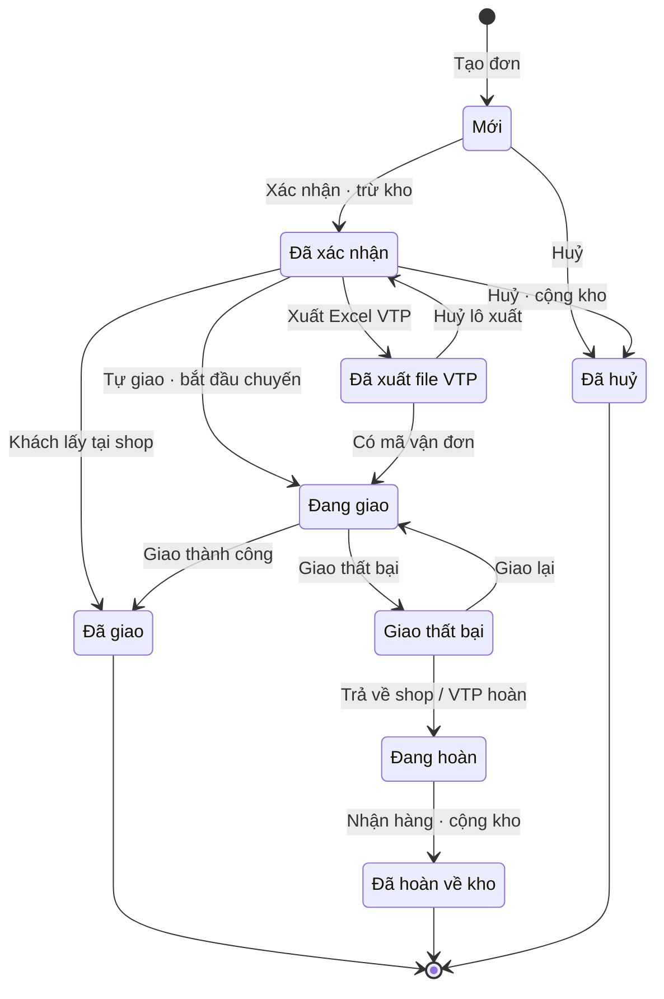
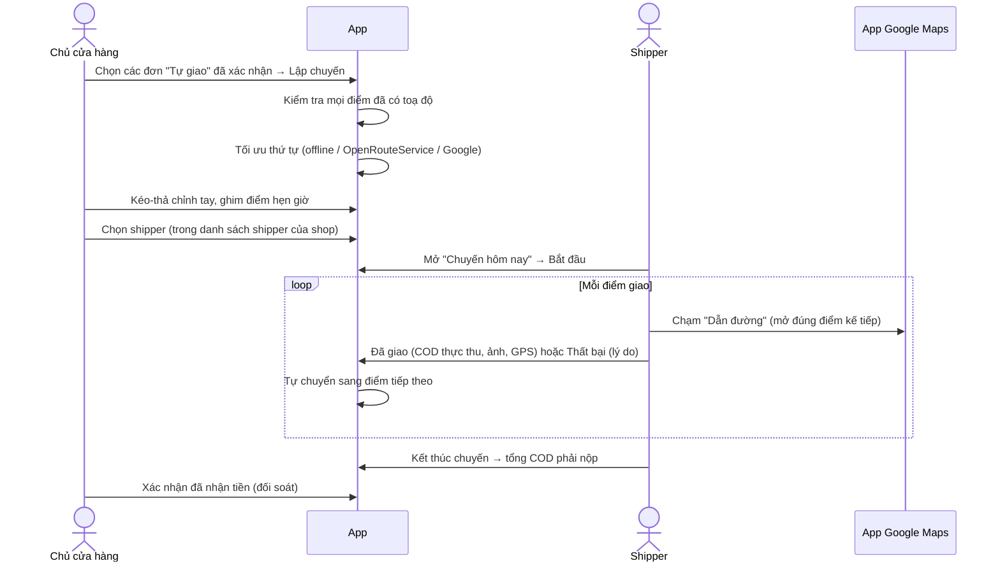
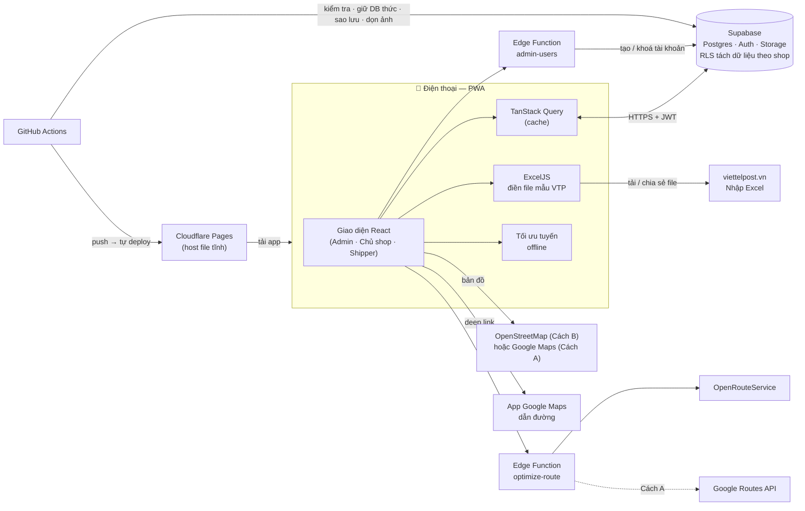
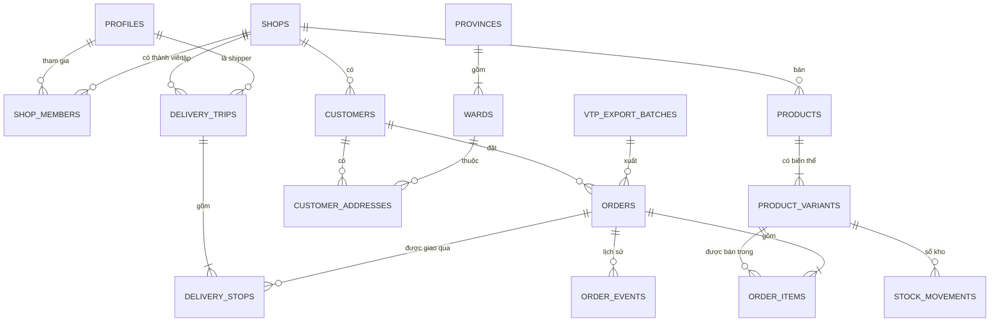

# Smart Delivery — Kế hoạch phát triển

> Ứng dụng quản lý **cửa hàng**, **đơn hàng**, **kho (theo biến thể)**, **khách hàng**; giúp **shipper sắp xếp tuyến giao** và dẫn đường bằng Google Maps; **xuất file Excel để tạo đơn hàng loạt trên ViettelPost**.
> Ưu tiên giao diện **điện thoại**. Ít người dùng. **Toàn bộ hạ tầng miễn phí (0đ/tháng).**

| | |
|---|---|
| Phiên bản | 1.0 — đã triển khai toàn bộ giai đoạn 0–7; ghi lại các điểm lệch so với kế hoạch và việc cần bạn làm khi cài đặt |
| Ngày | 13/11/2026 |
| Trạng thái | **Đã code xong GĐ 0–7** và kiểm thử tự động. **Chưa chạy với Supabase / ViettelPost thật.** Xem [mục 13](#13-tiến-độ-thực-hiện) và hướng dẫn cài đặt [docs/SETUP.md](SETUP.md) |

---

## Mục lục

0. [Nhật ký quyết định](#0-nhật-ký-quyết-định)
1. [Mục tiêu & phạm vi](#1-mục-tiêu--phạm-vi)
2. [Tính năng chi tiết](#2-tính-năng-chi-tiết)
3. [Kiến trúc & công nghệ](#3-kiến-trúc--công-nghệ)
4. [Thiết kế dữ liệu](#4-thiết-kế-dữ-liệu)
5. [Thiết kế giao diện điện thoại](#5-thiết-kế-giao-diện-điện-thoại)
6. [Lộ trình triển khai](#6-lộ-trình-triển-khai)
7. [Kiểm thử](#7-kiểm-thử)
8. [Bảo mật, dữ liệu cá nhân & sao lưu](#8-bảo-mật-dữ-liệu-cá-nhân--sao-lưu)
9. [Rủi ro & phương án](#9-rủi-ro--phương-án)
10. [Hướng mở rộng](#10-hướng-mở-rộng)
11. [Việc còn chờ](#11-việc-còn-chờ)
12. [Tài liệu tham khảo](#12-tài-liệu-tham-khảo)
13. [Tiến độ thực hiện](#13-tiến-độ-thực-hiện)
14. [Quy ước kỹ thuật](#14-quy-ước-kỹ-thuật)

---

## 0. Nhật ký quyết định

| # | Câu hỏi | Quyết định | Cần có trước |
|---|---|---|---|
| Q1 | File Excel mẫu tạo đơn hàng loạt của ViettelPost | ⏳ Bạn gửi sau. **Đã làm sẵn công cụ**: admin tải file mẫu lên và chọn cột nào chứa gì; trong lúc chờ dùng bố cục Excel chung | Trước khi dùng thật (xem [SETUP mục 10](SETUP.md#10-chuẩn-bị-dữ-liệu-cho-viettelpost)) |
| Q2 | Vai trò người dùng | ✅ **3 vai trò: Admin, Chủ cửa hàng, Shipper.** Chủ cửa hàng tự chọn shipper cho shop | — |
| Q3 | Dùng Google Maps (phải khai báo thẻ) hay không | ✅ **Chưa chọn nên làm Cách B (không thẻ)**: bản đồ OpenStreetMap, dẫn đường bằng app Google Maps (miễn phí). **Cách A (gợi ý địa chỉ khi gõ bằng Google) chưa làm**, có thể thêm sau | — |
| Q4 | Sản phẩm có biến thể không | ✅ **Có.** Tồn kho tính theo từng biến thể (màu/size…) | — |
| Q5 | Thời điểm trừ kho | ✅ **Khi xác nhận đơn.** Cộng lại khi huỷ hoặc nhận hàng hoàn | — |
| Q6 | Tin nhắn đặt hàng mẫu (để làm bộ tách địa chỉ) | ⏳ Bạn gửi sau. Bộ tách đã làm và kiểm thử với các mẫu chung; gửi tin thật để tinh chỉnh | Khi có |
| Q7 | Repo riêng tư | ⏳ Bạn đổi sau | Trước khi nhập dữ liệu thật |

**Chi tiết của Q2** (✅ chủ dự án đã xác nhận cả 4 điểm ngày 13/11/2026)

| # | Nội dung | Trạng thái |
|---|---|---|
| A1 | Hệ thống có thể có **nhiều cửa hàng**. Dữ liệu mỗi shop (sản phẩm, kho, khách, đơn, chuyến giao) **tách biệt hoàn toàn**: shop này không thấy dữ liệu shop kia | ✅ Đã xác nhận |
| A2 | **Admin tạo cửa hàng và tạo mọi tài khoản** (chủ cửa hàng, shipper). Admin xem và thao tác được trên mọi cửa hàng | ✅ Đã xác nhận |
| A3 | Shipper nằm trong **danh sách chung của hệ thống**. Chủ cửa hàng chọn shipper từ danh sách này để thêm vào shop mình. **Một shipper có thể làm cho nhiều shop** | ✅ Đã xác nhận |
| A4 | Đăng nhập bằng **SĐT + mật khẩu** (không dùng mã SMS vì SMS tốn phí) | ✅ Đã xác nhận |

Nếu thực tế chỉ có 1 cửa hàng, thiết kế này vẫn chạy bình thường, chỉ là ô chọn cửa hàng được ẩn đi.

---

## 1. Mục tiêu & phạm vi

### 1.1 Mục tiêu đo được

| # | Mục tiêu | Tiêu chí |
|---|---|---|
| G1 | Tạo đơn nhanh trên điện thoại | Khách cũ: < 30 giây. Khách mới (dán tin nhắn): < 60 giây |
| G2 | Tồn kho luôn đúng theo từng biến thể | Mọi thay đổi tồn đi qua sổ nhập–xuất, truy vết được từng dòng; không lệch khi huỷ/hoàn |
| G3 | Xuất Excel ViettelPost dùng được ngay | File tải lên VTP không có dòng lỗi do sai định dạng |
| G4 | Shipper giao theo tuyến tối ưu | Danh sách điểm đã sắp thứ tự; 1 chạm mở Google Maps dẫn đường tới điểm kế tiếp |
| G5 | Dữ liệu các shop tách biệt | Test tự động chứng minh shop A không đọc/ghi được dữ liệu shop B |
| G6 | Chi phí 0đ | Không có khoản thu phí nào phát sinh ở bất kỳ dịch vụ nào |

### 1.2 Vai trò & quyền

| Vai trò | Ai | Phạm vi |
|---|---|---|
| **Admin** | Bạn (1–2 người) | Toàn hệ thống: cửa hàng, tài khoản, danh mục dùng chung, theo dõi hạ tầng; vào thao tác được mọi shop |
| **Chủ cửa hàng** | 1 hoặc vài người / shop | Toàn quyền **trong shop của mình**, kể cả **chọn shipper** cho shop |
| **Shipper** | Nhiều người, dùng chung giữa các shop | Chỉ các **chuyến được giao cho mình**, có thể thuộc nhiều shop |

**Ma trận quyền**

| Chức năng | Admin | Chủ cửa hàng | Shipper |
|---|:---:|:---:|:---:|
| Tạo / khoá cửa hàng | ✅ | — | — |
| Tạo / khoá tài khoản, đặt lại mật khẩu | ✅ | — | — |
| Danh mục tỉnh/xã, file mẫu ViettelPost | ✅ | xem | — |
| Thêm / bỏ shipper khỏi shop | ✅ | ✅ shop mình | — |
| Sản phẩm, kho, khách hàng, đơn hàng | ✅ mọi shop | ✅ shop mình | — |
| Xuất Excel ViettelPost | ✅ | ✅ | — |
| Lập chuyến, giao chuyến cho shipper | ✅ | ✅ (chỉ chọn shipper của shop) | — |
| Xem chuyến, gọi khách, cập nhật kết quả giao | xem | xem | ✅ chuyến của mình |
| Đối soát tiền COD | ✅ | ✅ | xem phần của mình |
| Báo cáo | ✅ mọi shop | ✅ shop mình | — |
| Cài đặt shop (người gửi, mặc định VTP, quy tắc kho) | ✅ | ✅ | — |

Shipper **không bao giờ** thấy giá vốn, doanh thu, danh sách khách hàng, hay đơn không nằm trong chuyến của mình.

### 1.3 Quy mô giả định & dung lượng

≤ 5 cửa hàng · **tổng** ≤ 100 đơn/ngày · ≤ 2.000 biến thể/shop · ≤ 10.000 khách/shop · ≤ 20 tài khoản.

| Hạng mục | Ước tính | Gói miễn phí | Ghi chú |
|---|---|---|---|
| Cơ sở dữ liệu | ~3 KB/đơn (kèm dòng hàng, lịch sử, sổ kho) → ~110 MB/năm với 100 đơn/ngày | 500 MB | Đủ cho khoảng 4 năm. Admin xem dung lượng, cảnh báo khi > 70% |
| Ảnh sản phẩm | ~100 KB/ảnh (đã nén) × vài trăm ảnh | 1 GB (dùng chung với ảnh giao hàng) | |
| Ảnh bằng chứng giao hàng | Tuỳ chọn, nén còn ~50 KB, **tự xoá sau 30 ngày** | | Nếu không tự xoá, 100 ảnh/ngày sẽ đầy 1 GB sau vài tháng |

### 1.4 Ngoài phạm vi (giai đoạn đầu)

- **Không làm app native lên store**: Apple Developer tốn 99 USD/năm, Google Play 25 USD — trái tiêu chí miễn phí. Thay vào đó dùng **PWA** (web app cài được lên màn hình chính, chạy toàn màn hình như app thật).
- Không đồng bộ với sàn TMĐT (Shopee, TikTok Shop…), không kế toán / hoá đơn điện tử.
- Không có trang cho người lạ tự đăng ký; mọi tài khoản do admin tạo.
- Chưa gọi API ViettelPost ở bản đầu (để ở [mục 10](#10-hướng-mở-rộng)).

---

## 2. Tính năng chi tiết

Gồm 7 module. Mã module (M0–M6) dùng trong lộ trình ở mục 6.

### M0 — Quản trị hệ thống, cửa hàng & tài khoản

**Admin**
- **Cửa hàng**: tạo, sửa, khoá. Thông tin shop gồm tên, SĐT, địa chỉ lấy hàng, toạ độ và tiền tố mã đơn (VD `AB` → `AB261113-001`). Gán chủ cửa hàng cho shop.
- **Tài khoản**: tạo tài khoản chủ cửa hàng và shipper (họ tên, SĐT, mật khẩu tạm), đặt lại mật khẩu, khoá/mở.
- **Danh mục dùng chung**: danh mục tỉnh/xã, bảng tên cũ → mới, file mẫu ViettelPost và cấu hình cột.
- **Theo dõi hạ tầng**: dung lượng DB (/500 MB) và dung lượng file (/1 GB), cảnh báo khi > 70%.
- **Nhật ký thao tác quan trọng**: tạo/khoá tài khoản, thêm/bỏ shipper, huỷ đơn, điều chỉnh kho.
- **"Vào cửa hàng"**: admin mở bất kỳ shop nào và dùng giao diện như chủ shop. Trong lúc đó, đầu màn hình có dải thông báo "Đang xem shop X với quyền admin".

**Chủ cửa hàng — "Shipper của shop"**
- Tìm shipper trong danh sách chung theo tên hoặc SĐT, rồi bấm **Thêm vào shop**.
- **Bỏ khỏi shop**: không cho bỏ khi shipper đang có chuyến dở dang; các chuyến cũ vẫn giữ lại để đối soát.
- Mỗi shipper hiện: số chuyến tháng này, tỉ lệ giao thành công, **COD chưa nộp**.
- Khi lập chuyến, chỉ được chọn shipper đang thuộc shop.

**Đăng nhập & tài khoản**
- Đăng nhập bằng **SĐT + mật khẩu**. Phía dưới, app đổi SĐT thành một email nội bộ để dùng hệ thống đăng nhập của Supabase. Không cần SMS, không cần hộp thư thật.
- Bắt buộc đổi mật khẩu ở lần đăng nhập đầu tiên.
- Ai thuộc nhiều shop (admin, chủ nhiều shop) thì có **ô chọn cửa hàng** ở đầu màn hình. App nhớ shop dùng gần nhất.
- Shipper làm cho nhiều shop: màn "Chuyến hôm nay" gom chuyến của mọi shop, mỗi chuyến ghi rõ tên shop. **Mỗi chuyến chỉ chứa đơn của 1 shop.**

### M1 — Sản phẩm (có biến thể) & Kho

**Sản phẩm & biến thể**
- Thông tin chung: tên, danh mục, đơn vị, mô tả, ảnh.
- **Thuộc tính**: tối đa 3 (VD: Màu, Size, Chất liệu), mỗi thuộc tính có nhiều giá trị.
- App **tự sinh ma trận biến thể** (Đỏ/S, Đỏ/M, Xanh/S…). Bỏ chọn những tổ hợp không bán.
- **Mỗi biến thể là 1 SKU** với: mã SKU (tự gợi ý `AOTHUN-DO-M`, sửa được), giá bán, giá vốn, **khối lượng (gram, bắt buộc** — ViettelPost cần), kích thước D×R×C (tuỳ chọn), mã vạch, ảnh riêng (thường theo màu), ngưỡng cảnh báo tồn, đang bán/ngừng bán.
- **Sửa hàng loạt**: đặt giá / giá vốn / khối lượng cho mọi biến thể hoặc theo một giá trị (VD mọi size XL thêm 20.000đ).
- Sản phẩm không có biến thể vẫn có **1 biến thể mặc định (ẩn)**, nên mọi chỗ khác xử lý giống nhau.
- **Thêm thuộc tính / giá trị** sau khi đã bán vẫn được. Biến thể đã có đơn thì **chỉ được ngừng bán, không xoá**, để giữ lịch sử.
- Tìm kiếm **không dấu** theo tên sản phẩm, tên biến thể, SKU, mã vạch. Lọc theo danh mục, sắp hết hàng, ngừng bán.

**Nghiệp vụ kho (theo biến thể)**
- **Phiếu nhập kho**: chọn sản phẩm, nhập số lượng dạng **lưới** (hàng = màu, cột = size) cho nhanh trên điện thoại; giá nhập, nhà cung cấp, ghi chú.
- **Kiểm kho**: nhập số đếm thực tế (cũng dạng lưới), app tự tạo phiếu điều chỉnh phần chênh lệch.
- **Thẻ kho** của từng biến thể: lịch sử nhập / xuất theo đơn / huỷ / hoàn / điều chỉnh, kèm tồn sau mỗi giao dịch.
- Danh sách sản phẩm hiện **tổng tồn**; mở ra xem tồn từng biến thể. Biến thể sắp hết có nhãn cảnh báo.

**Quy tắc tồn kho** (✅ đã chốt Q5)
- Tồn được tính từ sổ nhập–xuất (`stock_movements`); cột `stock_qty` trên biến thể chỉ là bản cache, cập nhật trong cùng transaction.
- **Trừ kho khi xác nhận đơn**; cộng lại khi huỷ đơn đã xác nhận hoặc khi nhận lại hàng hoàn.
- Mặc định chặn xác nhận khi tồn không đủ; có công tắc trong Cài đặt shop để cho phép âm kho (hàng đặt trước).

### M2 — Khách hàng

**Hồ sơ khách** (riêng cho từng shop)
- Tên, SĐT (duy nhất trong shop, chuẩn hoá về dạng `0xxxxxxxxx`), SĐT phụ, nhãn (VIP, Khách sỉ, Hay hoàn hàng…), ghi chú.
- Nhiều địa chỉ / khách, 1 địa chỉ mặc định.
- Thống kê: số đơn, tổng chi, **tỉ lệ giao thành công / hoàn hàng**. Khi tạo đơn cho khách hay hoàn hàng, app hiện cảnh báo.
- Chạm để gọi điện, mở Zalo (`https://zalo.me/<sđt>`).
- Chống trùng: gõ SĐT đã có thì app gợi ý khách cũ thay vì tạo mới.

**Địa chỉ theo đơn vị hành chính mới**
- Từ 01/07/2025 cả nước còn **34 tỉnh/thành** và **3.321 xã/phường**, **không còn cấp quận/huyện**. Địa chỉ trong app lưu: `tỉnh` + `xã/phường` + `địa chỉ chi tiết` + toạ độ.
- Bảng **ánh xạ tên cũ → mới**: khách vẫn hay ghi "Quận 1", "P. Bến Nghé"…; app tự gợi ý đơn vị mới tương ứng.
- Danh mục tỉnh/xã **lấy theo đúng danh sách ViettelPost dùng trong file mẫu** để file xuất ra khớp tên 100% (xem M4).

**Dán tin nhắn (smart paste)** — ⏳ chờ tin nhắn mẫu (Q6)
Dán nguyên đoạn chat Zalo/Facebook, ví dụ:
`Chị Lan 0912 345 678, 12 Lê Lợi phường Bến Thành Q1 HCM`
→ app tách: tên `Chị Lan`, SĐT `0912345678`, địa chỉ chi tiết `12 Lê Lợi`, gợi ý `Phường Bến Thành, TP. Hồ Chí Minh`. Bạn chỉ cần kiểm lại rồi lưu.
Cách làm: regex SĐT Việt Nam, so khớp không dấu với danh mục và bảng tên cũ, chấm điểm, đưa ra 3 gợi ý tốt nhất. Bộ tin nhắn mẫu bạn gửi sẽ được dùng làm dữ liệu test.

**Toạ độ địa chỉ** (cần cho tối ưu tuyến)

| Cách | Cách A (Google) | Cách B (không thẻ) |
|---|:---:|:---:|
| Khách gửi **link Google Maps / ghim vị trí**, dán vào thì app tự đọc toạ độ | ✅ | ✅ |
| **Chọn trên bản đồ** (kéo ghim) | ✅ | ✅ |
| **Shipper ghim GPS** khi bấm "Đã giao" lần đầu, lần sau dùng lại. Đây là toạ độ chính xác nhất | ✅ | ✅ |
| **Gợi ý địa chỉ khi gõ** và tự tìm toạ độ từ địa chỉ chữ | ✅ | ❌ (dữ liệu bản đồ mở cho địa chỉ Việt Nam kém chính xác) |

### M3 — Đơn hàng

**Tạo đơn trên 1 màn hình cuộn**, 3 khối: Khách → Sản phẩm → Thanh toán & giao hàng. Thanh tổng tiền và nút "Xác nhận" luôn ghim ở đáy màn hình.

**Chọn sản phẩm có biến thể**: tìm sản phẩm, rồi chọn biến thể trong bottom sheet.
- Các thuộc tính hiện dạng **chip**; chip của tổ hợp hết hàng bị làm mờ.
- Hiện tồn và giá của tổ hợp đang chọn.
- Có nút +/− số lượng.
- Một đơn có thể có nhiều biến thể của cùng một sản phẩm.

| Nhóm | Trường |
|---|---|
| Định danh | Cửa hàng, mã đơn tự sinh `<tiền tố><yymmdd>-<stt>`, ngày tạo, người tạo |
| Khách | Khách + địa chỉ giao. **Lưu bản sao (snapshot)** tên/SĐT/địa chỉ vào đơn để sau này khách đổi địa chỉ không làm sai đơn cũ |
| Hàng | Các dòng: biến thể, số lượng, đơn giá (sửa được); snapshot tên sản phẩm, tên biến thể, SKU, giá vốn tại thời điểm bán |
| Tiền | Tạm tính, phí ship thu khách, giảm giá, **tổng**, đã cọc/chuyển khoản, **tiền thu hộ COD = tổng − đã trả** |
| Giao hàng | Phương thức: **Tự giao** / **ViettelPost** / **Khách lấy tại shop**. Khối lượng = Σ(khối lượng biến thể × SL) + bao bì (sửa được). Ghi chú giao hàng, ghi chú nội bộ |
| ViettelPost | Mã dịch vụ, người trả cước, yêu cầu khi giao (lấy mặc định từ Cài đặt shop), mã vận đơn, lô xuất Excel |

**Vòng đời đơn hàng**



**Quy tắc**
- Mọi chuyển trạng thái chạy qua **hàm SQL (RPC) trong 1 transaction**: đổi trạng thái, ghi tồn kho và ghi lịch sử cùng thành công hoặc cùng thất bại, không bao giờ lệch.
- Đơn đã xác nhận muốn sửa dòng hàng thì bấm **"Mở lại"**: app hoàn kho, cho sửa, rồi xác nhận lại.
- Mỗi lần đổi trạng thái lưu vào `order_events` (ai, lúc nào, ghi chú) và hiện thành dòng thời gian trong chi tiết đơn.

**Danh sách đơn**
- Tab theo trạng thái kèm số đếm; lọc theo ngày, phương thức giao, khách; tìm theo mã đơn / SĐT / tên.
- **Chọn nhiều → hành động hàng loạt**: Xác nhận · Lập chuyến giao · Xuất Excel VTP · Huỷ.
- Nhân bản đơn (khách quen mua lại), chia sẻ nội dung đơn dạng text qua Zalo để xác nhận với khách.

### M4 — Xuất Excel tạo đơn hàng loạt ViettelPost

⏳ **Chờ file mẫu thật (Q1).** Các phần dưới đây là thiết kế; danh sách cột sẽ chốt khi có file.

**Quy trình trên ViettelPost** (theo các hướng dẫn công khai): trên web viettelpost.vn chọn *Tạo đơn* → *Nhập Excel* → tải file mẫu → điền → tải lên. Hệ thống báo dòng nào hợp lệ, dòng nào lỗi. App sẽ làm thay bước *điền*.

**Thiết kế: điền vào chính file mẫu của VTP**
1. **File mẫu gốc**: admin tải lên 1 lần, dùng chung cho mọi shop. Mỗi shop dùng tài khoản VTP riêng nhưng cùng một mẫu.
2. **Cấu hình ánh xạ cột** do admin quản lý (bản đầu viết trong file `template.config.ts`): dòng tiêu đề, dòng bắt đầu điền, và cột nào lấy từ trường nào. Khi VTP đổi mẫu chỉ cần sửa cấu hình.
3. **Điền dữ liệu bằng ExcelJS ngay trên điện thoại**, không cần server. Giữ nguyên định dạng, danh sách thả xuống và các sheet danh mục của file mẫu.
4. **Kiểm tra trước khi xuất**: SĐT hợp lệ, tỉnh/xã khớp danh mục VTP, khối lượng > 0, COD ≥ 0, độ dài các trường đúng giới hạn. Dòng lỗi tô đỏ, chạm vào là sửa được ngay.
5. **Xuất file**: tải về, hoặc **chia sẻ** (Web Share API) sang Zalo / Google Drive / email để mở trên máy tính rồi tải lên VTP. Tên file dạng `VTP_<shop>_20261113_15don.xlsx`.
6. **Ghi lô xuất**: lưu lô gồm những đơn nào, xuất lúc nào; đơn chuyển sang "Đã xuất file VTP". Nếu chọn lại đơn đã nằm trong lô trước, app cảnh báo xuất trùng.
7. **Nhập ngược mã vận đơn**: sau khi tạo đơn trên VTP, tải danh sách đơn từ VTP (Excel) rồi đưa vào app. App khớp theo *mã đơn riêng của shop* (hoặc SĐT + COD), điền mã vận đơn và chuyển đơn sang "Đang giao". Vẫn có thể dán mã thủ công.

**Các cột dự kiến** (⚠️ **phải đối chiếu với file mẫu thật**)

| Nhóm | Dữ liệu điền | Nguồn trong app |
|---|---|---|
| Người nhận | Tên, SĐT, địa chỉ chi tiết, Tỉnh/TP, Xã/Phường (thêm Quận/Huyện nếu mẫu còn yêu cầu) | Snapshot địa chỉ trên đơn |
| Hàng hoá | Tên hàng, gộp kèm biến thể: `Áo thun (Đỏ/M) x2; Quần jean (30) x1`. Số lượng, khối lượng (g), giá trị hàng, kích thước | `order_items` |
| Tiền | Tiền thu hộ COD, người trả cước | Đơn + Cài đặt shop |
| Dịch vụ | Mã dịch vụ, dịch vụ cộng thêm, yêu cầu khi giao (cho xem / không cho xem / cho thử) | Đơn (mặc định từ Cài đặt shop) |
| Khác | **Mã đơn riêng của shop**, ghi chú | Đơn — dùng để nhập ngược mã vận đơn |

> **Việc đầu tiên khi có file mẫu**: đọc dòng tiêu đề, danh sách thả xuống và sheet danh mục (nếu có), rồi chốt ánh xạ. Sau đợt sáp nhập hành chính 07/2025, mẫu có thể đã chuyển sang địa chỉ 2 cấp (Tỉnh – Xã) hoặc vẫn 3 cấp; tên đơn vị phải khớp đúng danh mục VTP. Nếu tên hàng có giới hạn độ dài, app tự rút gọn (VD `Áo thun (Đỏ/M) x2 +2 SP khác`).
> Nếu file mẫu là `.xls` (định dạng cũ, ExcelJS không đọc được): chuyển sang `.xlsx` một lần bằng Excel/LibreOffice, rồi thử xem VTP có nhận `.xlsx` không.

### M5 — Giao hàng & tối ưu tuyến cho shipper

**Luồng làm việc**



**Chi tiết**
- Điểm xuất phát: GPS hiện tại hoặc địa chỉ shop. Điểm kết thúc: quay về shop hoặc dừng ở điểm cuối.
- Điểm nào chưa có toạ độ thì phải bổ sung trước (theo các cách ở M2).
- Thẻ điểm giao: số thứ tự, tên, địa chỉ, **tiền COD cần thu**, ghi chú, khoảng cách tới điểm. Nút: 📞 Gọi · 💬 Zalo · 🧭 Dẫn đường · ✅ Đã giao · ❌ Thất bại.
- Lý do thất bại chọn nhanh: không nghe máy, hẹn ngày khác, sai địa chỉ, khách từ chối nhận, khác.
- Ảnh bằng chứng (tuỳ chọn) được nén còn khoảng 50 KB và **tự xoá sau 30 ngày**.
- Đơn giao thất bại có thể đưa vào chuyến sau, hoặc chuyển sang "Đang hoàn".
- Chủ cửa hàng có thể đổi shipper của chuyến khi chuyến chưa bắt đầu.

**Tối ưu thứ tự điểm giao — 3 tầng, đều miễn phí**

| Tầng | Cách làm | Ưu điểm | Hạn chế | Khi dùng |
|---|---|---|---|---|
| **A. Offline** | Khoảng cách đường chim bay (haversine) + Nearest Neighbor + cải thiện 2-opt, chạy trong trình duyệt | Không tốn lượt API, tức thì, không giới hạn | Không tính đường một chiều, sông, cầu | Luôn có sẵn; dự phòng khi mất mạng hoặc hết lượt |
| **B. OpenRouteService** (`/optimization`, engine VROOM) | Gửi toạ độ, nhận thứ tự tối ưu theo đường thật (dữ liệu OpenStreetMap) | Miễn phí, **không cần thẻ** | Không có chế độ xe máy (dùng ô tô gần đúng); hạn mức khoảng vài trăm lượt/ngày (đủ dùng) | **Mặc định** khi có mạng |
| **C. Google Routes API** (`optimizeWaypointOrder`) | Tối đa 25 điểm trung gian / lần | Dữ liệu đường Việt Nam tốt nhất | Chỉ có ở Cách A (có thẻ); tính vào hạn mức miễn phí của SKU tương ứng (kiểm tra SKU khi làm) | Tuỳ chọn |

Lời gọi B và C đi qua 1 **Supabase Edge Function** (`optimize-route`) để giấu API key và kiểm tra đăng nhập.

**Dẫn đường: Google Maps URLs** (không cần API key, không cần thẻ, không tính phí — dùng được ở cả Cách A và B)

```
https://www.google.com/maps/dir/?api=1&destination=<lat>,<lng>&travelmode=<mode>&dir_action=navigate
```

- **Mặc định dẫn từng điểm một**: ổn định nhất trên điện thoại và không vướng giới hạn số điểm dừng của link.
- Nút phụ "Xem cả tuyến": app chia tuyến thành nhiều link có `waypoints`. Số điểm dừng tối đa trên mỗi link (nhất là trên điện thoại) và giá trị `travelmode` cho xe máy sẽ được **kiểm thử thực tế trên máy Android/iOS** khi làm M5.

### M6 — Tổng quan, báo cáo, cài đặt shop

**Tổng quan (trang chủ của chủ cửa hàng)**
- Hôm nay: đơn mới, chờ xử lý, đang giao, đã giao; doanh thu; COD chưa thu.
- Cảnh báo: biến thể sắp hết, đơn VTP quá N ngày chưa có mã vận đơn, đơn giao thất bại chờ xử lý, chuyến chưa đối soát.
- Lối tắt: Tạo đơn · Xuất Excel VTP · Lập chuyến · Nhập kho.

**Báo cáo** (chọn khoảng ngày)
- Doanh thu và lợi nhuận gộp (giá bán − giá vốn).
- Sản phẩm bán chạy, xem theo sản phẩm hoặc theo biến thể (để biết size/màu nào chạy).
- Khách mua nhiều.
- Tỉ lệ hoàn theo phương thức giao.
- Hiệu suất shipper.

Admin xem được báo cáo gộp tất cả shop.

**Xuất dữ liệu ra Excel** (đơn, sản phẩm, khách), dùng luôn làm sao lưu thủ công.

**Cài đặt shop**
- Thông tin người gửi: tên, SĐT, địa chỉ lấy hàng, toạ độ.
- Mặc định ViettelPost: dịch vụ, người trả cước, yêu cầu khi giao, khối lượng bao bì.
- Quy tắc kho: cho phép âm kho hay không.
- Mẫu tin nhắn xác nhận đơn.

---

## 3. Kiến trúc & công nghệ

### 3.1 Sơ đồ tổng thể



Không có server riêng phải nuôi.
- Logic nghiệp vụ quan trọng (kho, trạng thái đơn, phân quyền) nằm trong **Postgres**: hàm SQL và Row Level Security.
- Hai việc cần khoá bí mật chạy trên **Edge Function**: tạo tài khoản và gọi dịch vụ tối ưu tuyến.
- Phần còn lại chạy trên điện thoại.

### 3.2 Lựa chọn công nghệ

| Lớp | Chọn | Lý do |
|---|---|---|
| Dạng app | **PWA**: React + TypeScript + Vite + `vite-plugin-pwa` | 1 bộ code cho iOS/Android/máy tính; cài lên màn hình chính; không tốn phí store |
| Giao diện | Tailwind CSS + shadcn/ui (Radix) + `vaul` (bottom sheet) + lucide icons | Dễ làm mobile-first, nhẹ, tuỳ biến tốt |
| Điều hướng | React Router (cây route riêng cho từng vai trò) | Phổ biến, đủ dùng |
| Dữ liệu phía client | TanStack Query (cache, lưu tạm vào IndexedDB), `react-hook-form` + `zod` | Màn hình mở nhanh, form có kiểm tra dữ liệu chặt |
| Backend | **Supabase**: Postgres + Auth + Storage + Row Level Security + RPC + Edge Functions | Gói miễn phí đủ dùng; SQL + transaction giữ tồn kho đúng; RLS tách dữ liệu theo shop và theo vai trò |
| Hosting | **Cloudflare Pages** (tên miền miễn phí `*.pages.dev`) | Miễn phí, file tĩnh không giới hạn băng thông, cho phép dùng cho việc kinh doanh (gói Hobby của Vercel chỉ cho mục đích phi thương mại) |
| Excel | **ExcelJS** (chạy trên trình duyệt) | Đọc file mẫu, điền dữ liệu, giữ định dạng |
| Bản đồ | Cách B: **Leaflet + OpenStreetMap**. Cách A: **Google Maps JS API** + Places | Có lớp trung gian `MapProvider`, đổi bằng 1 cài đặt hệ thống (xem 3.3) |
| Dẫn đường | Google Maps URLs | Không cần key, không tính phí |
| Tối ưu tuyến | Thuật toán tự viết + OpenRouteService (+ Google Routes ở Cách A) | Xem M5 |
| CI/CD | GitHub Actions + Cloudflare Pages kết nối Git | Push là tự deploy, mỗi nhánh có link xem thử |
| Kiểm thử | Vitest, Testing Library, Playwright (khung hình điện thoại) | |
| Theo dõi lỗi | Sentry gói Developer miễn phí | Tuỳ chọn |

**Các phương án đã cân nhắc nhưng không chọn**
- *Firebase (Firestore)*: NoSQL khó đảm bảo tồn kho bằng transaction nhiều bảng và khó làm báo cáo; Cloud Functions bắt buộc gói trả phí Blaze.
- *App native (Flutter/React Native) lên store*: tốn phí tài khoản developer.
- *Google Sheets + Apps Script*: rẻ và nhanh nhưng chậm, khó phân quyền 3 vai trò, dễ hỏng dữ liệu.
- **Phương án B về backend**: Cloudflare Workers + D1 (SQLite). Không bị tạm dừng khi ít dùng, nhưng phải tự viết API, đăng nhập và phân quyền. Chuyển sang nếu chính sách gói miễn phí của Supabase thay đổi bất lợi.

### 3.3 Bản đồ & địa chỉ: 2 cách, chờ bạn chọn (Q3)

**Giải thích ngắn**: Google cho dùng **miễn phí** bản đồ, gợi ý địa chỉ và tìm toạ độ trong một hạn mức mỗi tháng (10.000 lượt cho mỗi loại cơ bản). Nhu cầu của app chỉ vài trăm lượt/tháng. Tuy vậy, Google **bắt buộc khai báo thẻ thanh toán quốc tế** (Visa/Mastercard, thẻ ghi nợ cũng được) thì mới bật được các dịch vụ này. Khi khai báo, Google có thể tạm giữ một khoản nhỏ để xác minh thẻ rồi hoàn lại. App sẽ đặt **giới hạn cứng số lượt mỗi ngày** thấp hơn mức miễn phí: chạm giới hạn thì Google từ chối thêm yêu cầu chứ không tính tiền. Nếu bạn không muốn khai báo thẻ thì dùng Cách B.

| | **Cách A — Google (có khai báo thẻ)** | **Cách B — Không thẻ** |
|---|---|---|
| Gõ địa chỉ có gợi ý tự động | ✅ | ❌ gõ tay, chọn tỉnh/xã từ danh sách |
| Tự tìm toạ độ từ địa chỉ chữ | ✅ chính xác | ❌ phải dùng link Maps khách gửi, ghim trên bản đồ hoặc GPS shipper |
| Bản đồ hiển thị trong app | Google Maps | OpenStreetMap (chi tiết kém hơn ở ngõ hẻm) |
| Tối ưu thứ tự điểm giao | OpenRouteService + Google (tuỳ chọn) | OpenRouteService |
| **Dẫn đường bằng app Google Maps** | ✅ | ✅ (như nhau, không cần thẻ) |
| Rủi ro mất tiền | Có, nhưng chặn bằng giới hạn cứng mỗi ngày + cảnh báo ngân sách | Không |
| Công sức nhập liệu | Ít | Nhiều hơn với khách mới (lần giao đầu shipper ghim GPS, từ lần sau như Cách A) |

**Khuyến nghị**: nếu khai báo thẻ không phải vấn đề, chọn **Cách A** vì nhập địa chỉ nhanh và toạ độ chính xác. Nếu muốn tuyệt đối không dính thẻ, **Cách B** vẫn dùng tốt, chỉ thêm thao tác với khách mới.
**Hiện trạng:** bản này chỉ có Cách B. Muốn thêm Cách A cần bổ sung phần gợi ý địa chỉ / tìm toạ độ bằng Google (ô nhập địa chỉ và `LocationSheet`); các phần còn lại (dẫn đường, link Maps, GPS shipper) giữ nguyên.

**Nếu chọn Cách A — bảo đảm 0đ**
- Trong Google Cloud Console, **đặt quota cứng theo ngày** cho từng API, ví dụ Maps JS 300/ngày, Places 300/ngày, Geocoding 300/ngày, Routes 100/ngày. Tổng cả tháng luôn dưới hạn mức miễn phí (Essentials 10.000, Pro 5.000, Enterprise 1.000 lượt/tháng/SKU, áp dụng từ 03/2025).
- Đặt **cảnh báo ngân sách 1 USD** (chỉ để báo, không chặn).
- API key: giới hạn theo **HTTP referrer** (chỉ tên miền của app) và chỉ bật đúng các API cần dùng.
- Places Autocomplete: dùng session token, chờ 300 ms sau khi ngừng gõ, tối thiểu 3 ký tự.
- Điều khoản Google chỉ cho lưu tạm toạ độ lấy từ Google tối đa 30 ngày, còn `place_id` thì lưu lâu dài được. Vì vậy lưu thêm `place_id`, `geo_source`, `geocoded_at`, và làm mới toạ độ của các điểm trong chuyến khi đã quá hạn. Toạ độ do shipper ghim GPS hoặc khách gửi là dữ liệu của mình, lưu thoải mái.

### 3.4 Hạ tầng miễn phí & hạn mức

| Dịch vụ | Gói | Hạn mức chính (theo nguồn công khai, tra lại khi đăng ký) | Ước tính dùng | Lưu ý |
|---|---|---|---|---|
| **Supabase** | Free | 500 MB DB, 1 GB file, 5 GB egress/tháng, 50.000 người dùng hoạt động/tháng, 2 project, Edge Functions | Xem [mục 1.3](#13-quy-mô-giả-định--dung-lượng) | **Tạm dừng sau 7 ngày không hoạt động**, xử lý bằng cron giữ thức. Gói free không có bản sao lưu tải về, nên tự sao lưu. Chọn vùng Singapore cho nhanh |
| **Cloudflare Pages** | Free | 500 lượt build/tháng; file tĩnh không giới hạn băng thông | ~50 build/tháng | |
| **GitHub** | Free | Actions: repo công khai không giới hạn; repo riêng tư 2.000 phút/tháng | ~40 phút/tháng | Nên để repo **riêng tư** (Q7) |
| **OpenRouteService** | Standard (miễn phí) | Directions khoảng 2.000 lượt/ngày; optimization khoảng 500 lượt/ngày (số cũ, cần kiểm tra lại) | < 30 lượt/ngày | Key miễn phí, không cần thẻ |
| **OpenStreetMap tiles** (Cách B) | Miễn phí, theo chính sách sử dụng | Chỉ dùng mức nhẹ, phải ghi nguồn | Vài trăm lượt xem/ngày | Nếu bị giới hạn, đổi sang nhà cung cấp tile miễn phí khác |
| **Google Maps Platform** (Cách A) | Trả theo dùng, có hạn mức miễn phí theo SKU | Essentials 10.000 / Pro 5.000 / Enterprise 1.000 lượt/tháng/SKU | Vài trăm lượt/tháng | Khai báo thẻ + giới hạn cứng mỗi ngày |
| **Sentry** | Developer | 5.000 lỗi/tháng | Rất ít | Tuỳ chọn |

**Giữ Supabase không bị tạm dừng** (gói miễn phí dừng sau khoảng 7 ngày không hoạt động) bằng nhiều lớp độc lập:
1. Hàm công khai `keepalive()` **ghi** 1 dòng vào bảng `system_heartbeat` (tối đa 1 lần/giờ nên không ai lạm dụng được) và trả về lần gọi gần nhất.
2. GitHub Actions gọi hàm này 2 lần/ngày, rồi **kiểm tra** nhịp tim còn mới; nếu không thì workflow báo lỗi và GitHub gửi email.
3. Cloudflare Worker (`workers/keepalive`) gọi độc lập 2 lần/ngày, phòng khi GitHub tắt workflow định kỳ (repo công khai sau 60 ngày không hoạt động) hoặc chạy trễ.
4. Trang Hệ thống của admin hiện thẻ cảnh báo xanh / vàng / đỏ theo tuổi của lần gọi gần nhất (`admin_heartbeat`); đỏ từ 5 ngày.
5. Màn đăng nhập và màn tải dữ liệu giải thích “project có thể đã bị tạm dừng” khi không kết nối được máy chủ.
6. Sao lưu mã hoá hằng tuần làm lưới an toàn cuối cùng.

**Giới hạn:** Supabase không công bố chính xác thế nào là “hoạt động”, và chưa kiểm chứng với project thật. Nếu vẫn bị tạm dừng, vào dashboard bấm *Restore* (dữ liệu không mất, khôi phục được trong khoảng 90 ngày). Cách duy nhất loại bỏ hẳn việc tạm dừng là gói Pro (có phí), việc này do chủ dự án quyết định.

### 3.5 Cấu trúc thư mục

```
smart-delivery/
├─ docs/
│  └─ PLAN.md                    ← tài liệu này
├─ public/
│  └─ icons/                     ← icon PWA
├─ src/
│  ├─ app/                       ← router theo vai trò, layout, bottom nav, chọn cửa hàng, providers
│  ├─ components/ui/             ← shadcn/ui + component dùng chung (MoneyInput, PhoneInput, BottomSheet, VariantPicker, QtyGrid…)
│  ├─ features/
│  │  ├─ auth/                   ← đăng nhập SĐT, đổi mật khẩu
│  │  ├─ admin/                  ← cửa hàng, tài khoản, danh mục, hạ tầng, nhật ký
│  │  ├─ shop-shippers/          ← chủ shop chọn / bỏ shipper
│  │  ├─ dashboard/
│  │  ├─ products/               ← sản phẩm, thuộc tính, ma trận biến thể
│  │  ├─ inventory/              ← nhập kho, kiểm kho (lưới), thẻ kho
│  │  ├─ customers/              ← khách, địa chỉ, smart paste
│  │  ├─ orders/
│  │  ├─ viettelpost/            ← template.config.ts, exporter, importer mã vận đơn
│  │  ├─ delivery/               ← lập chuyến, màn shipper, route-optimizer
│  │  ├─ reports/
│  │  └─ settings/
│  ├─ lib/
│  │  ├─ supabase.ts             ← client + types sinh tự động
│  │  ├─ vn/                     ← chuẩn hoá SĐT, bỏ dấu, tách địa chỉ, định dạng tiền
│  │  ├─ maps/                   ← MapProvider (leaflet | google), deep link, haversine
│  │  └─ excel/
│  └─ main.tsx
├─ supabase/
│  ├─ migrations/                ← schema, RLS, hàm RPC (SQL)
│  ├─ seed/                      ← danh mục tỉnh/xã + bảng ánh xạ tên cũ; dữ liệu demo
│  ├─ functions/
│  │  ├─ admin-users/            ← tạo / khoá tài khoản, đặt lại mật khẩu (chỉ admin)
│  │  └─ optimize-route/         ← proxy ORS / Google Routes
│  └─ tests/                     ← test SQL cho RPC & RLS (cô lập dữ liệu giữa shop)
├─ tests/e2e/                    ← Playwright
├─ workers/keepalive/            ← Cloudflare Worker gọi keepalive() (lớp bảo vệ thứ hai)
└─ .github/workflows/
   ├─ ci.yml                     ← lint, typecheck, test
   ├─ keepalive.yml              ← gọi keepalive() 2 lần/ngày và kiểm tra nhịp tim
   ├─ backup.yml                 ← sao lưu DB hằng tuần
   └─ cleanup.yml                ← xoá ảnh bằng chứng giao hàng > 30 ngày
```

**Biến môi trường**
- Đưa vào app: `VITE_SUPABASE_URL`, `VITE_SUPABASE_PUBLISHABLE_KEY`, `VITE_MAP_PROVIDER` (`osm` / `google`), `VITE_GOOGLE_MAPS_API_KEY` (chỉ Cách A, đã giới hạn referrer).
- Bí mật phía server, cất trong Supabase/GitHub Secrets, không đưa vào app: `SUPABASE_SERVICE_ROLE_KEY` (Edge Function `admin-users`), `ORS_API_KEY`, `GOOGLE_ROUTES_API_KEY`, `SUPABASE_DB_URL` (sao lưu), `BACKUP_PUBLIC_KEY`.

---

## 4. Thiết kế dữ liệu

### 4.1 Sơ đồ quan hệ



**Mọi bảng nghiệp vụ đều có `shop_id`.** Đây là chìa khoá để RLS tách dữ liệu giữa các shop. Chỉ danh mục tỉnh/xã và cấu hình hệ thống là dùng chung.

### 4.2 Các bảng

> Tiền lưu `bigint` (đồng, không có số lẻ). Thời gian lưu `timestamptz`. Khoá chính `uuid`, riêng danh mục hành chính dùng mã.
> Các cột `*_search` = chữ thường, bỏ dấu (`unaccent`), có index `pg_trgm` để tìm kiếm không dấu và gần đúng.

**Hệ thống & phân quyền**

| Bảng | Cột chính |
|---|---|
| `profiles` | `id` (= auth.users.id), `full_name`, `phone` (duy nhất), `account_type` (admin / owner / shipper), `active`, `must_change_password` |
| `shops` | `id`, `name`, `phone`, `address_detail`, `province_code`, `ward_code`, `lat`, `lng`, `order_prefix` (**duy nhất toàn hệ thống**, 1–5 ký tự in hoa/số), `active`, `created_by`. Bản nháp M0 dùng một cột `address` dạng chữ; `province_code` / `ward_code` thêm ở M2 |
| `shop_members` | `shop_id`, `user_id`, `role` (owner / shipper), `active`, `added_by`, `added_at` — khoá chính (`shop_id`, `user_id`). **Trigger** chặn vai trò không khớp loại tài khoản (owner ↔ owner, shipper ↔ shipper) |
| `shop_settings` | `shop_id`, thông tin người gửi, `vtp_default_service`, `vtp_fee_payer`, `vtp_delivery_requirement`, `packaging_weight_g`, `allow_negative_stock`, mẫu tin nhắn |
| `system_settings` (1 dòng) | `map_provider`, `vtp_template_path`, `vtp_template_version`, `vtp_column_mapping` (jsonb) |
| `audit_logs` | `id`, `shop_id` (có thể rỗng), `actor_id`, `action`, `target_type`, `target_id`, `data` (jsonb), `created_at` |
| `provinces` / `wards` / `ward_aliases` | Danh mục dùng chung: `code`, `name`, `name_search`; `wards.province_code`; `ward_aliases.alias_search → ward_code` |

**Sản phẩm & kho**

| Bảng | Cột chính |
|---|---|
| `products` | `id`, `shop_id`, `name`, `name_search`, `category`, `unit`, `description`, `image_path`, `option_names` (mảng, ≤ 3, VD `{Màu,Size}`), `active` |
| `product_variants` | `id`, `shop_id`, `product_id`, `sku` (duy nhất trong shop), `option_values` (mảng, VD `{Đỏ,M}`), `variant_label` (`Đỏ / M`), `price`, `cost`, `weight_g`, `length_cm`, `width_cm`, `height_cm`, `barcode`, `image_path`, `stock_qty` (cache), `low_stock_threshold`, `is_default`, `active` |
| `stock_movements` | `id`, `shop_id`, `variant_id`, `qty_change` (+/−), `type` (receipt / order_out / order_cancel / return / adjust), `unit_cost`, `ref_type`, `ref_id`, `stock_after`, `note`, `created_by`, `created_at` |
| `stock_receipts` / `stock_receipt_items` | Phiếu nhập: `shop_id`, `code`, `supplier`, `note`, `total_cost` / `variant_id`, `qty`, `unit_cost` |
| `stocktakes` / `stocktake_items` | Phiếu kiểm kho: `shop_id`, `code`, `note` / `variant_id`, `system_qty`, `counted_qty`, `diff` |

**Khách hàng & đơn hàng**

| Bảng | Cột chính |
|---|---|
| `customers` | `id`, `shop_id`, `name`, `name_search`, `phone` (duy nhất trong shop), `phone2`, `tags[]`, `note`, `order_count`, `delivered_count`, `returned_count`, `total_spent` |
| `customer_addresses` | `id`, `shop_id`, `customer_id`, `label`, `detail`, `province_code`, `ward_code`, `full_text`, `lat`, `lng`, `geo_source` (gps / link / manual / google / ors), `place_id`, `geocoded_at`, `is_default` |
| `orders` | `id`, `shop_id`, `code` (duy nhất trong shop), `customer_id`; snapshot `ship_name`, `ship_phone`, `ship_detail`, `ship_province_code`, `ship_ward_code`, `ship_lat`, `ship_lng`; `status`, `delivery_method` (self / vtp / pickup); `subtotal`, `shipping_fee`, `discount`, `total`, `paid_amount`, `cod_amount`, `weight_g`; `delivery_note`, `internal_note`; `vtp_service`, `vtp_fee_payer`, `vtp_tracking_code`, `vtp_batch_id`; `confirmed_at`, `delivered_at`, `cancelled_at`, `created_by` |
| `order_items` | `id`, `shop_id`, `order_id`, `variant_id`; snapshot `product_name`, `variant_label`, `sku`, `unit_cost`, `weight_g`; `qty`, `unit_price` |
| `order_events` | `shop_id`, `order_id`, `from_status`, `to_status`, `note`, `actor_id`, `created_at` |
| `vtp_export_batches` | `id`, `shop_id`, `file_name`, `order_count`, `template_version`, `created_by`, `created_at` |

**Giao hàng**

| Bảng | Cột chính |
|---|---|
| `delivery_trips` | `id`, `shop_id`, `code`, `trip_date`, `shipper_id`, `start_lat`, `start_lng`, `end_mode` (return / last), `status` (draft / in_progress / done), `optimizer` (local / ors / google), `distance_m`, `duration_s`, `cod_expected`, `cod_collected`, `settled_at`, `settled_by` |
| `delivery_stops` | `id`, `shop_id`, `trip_id`, `order_id`, `seq`, `status` (pending / delivered / failed / skipped), `fail_reason`, `cod_collected`, `proof_photo_path`, `done_at`, `done_lat`, `done_lng` |

### 4.3 Hàm nghiệp vụ (RPC, chạy trong transaction)

| Nhóm | Hàm | Việc làm |
|---|---|---|
| Quản trị (M0 — **đã có trong bản nháp**) | Edge Function `admin-users` | Hành động `create` / `update` / `reset_password` / `set_active`: tạo tài khoản (SĐT → email nội bộ), sửa tên/SĐT, đặt lại mật khẩu tạm, khoá/mở. Chỉ admin gọi được |
| | `my_context()` | Hồ sơ người đang đăng nhập + các shop đang hoạt động mà họ thuộc về (kèm vai trò) |
| | `mark_password_changed()` | Bỏ cờ "phải đổi mật khẩu tạm" sau khi người dùng đổi mật khẩu |
| | `admin_list_shops()` | Danh sách shop kèm chủ shop và số shipper |
| | `admin_create_shop(name, order_prefix, phone, address)` / `admin_update_shop(...)` | Tạo / sửa shop, kể cả tiền tố mã đơn và khoá/mở shop |
| | `admin_set_shop_owner(shop_id, user_id, active)` | Gán hoặc bỏ chủ cửa hàng |
| | `admin_list_accounts(account_type, query)` | Danh sách tài khoản, lọc theo loại, tìm không dấu, kèm các shop |
| | `admin_db_usage()` | Dung lượng DB để theo dõi giới hạn 500 MB |
| | `list_shop_members(shop_id)` | Chủ shop xem thành viên của shop (kể cả đã bỏ) |
| | `search_shippers(shop_id, query)` | Chủ shop tìm trong danh sách shipper chung (chỉ trả về tên, SĐT, đã thuộc shop chưa) |
| | `add_shop_shipper(shop_id, user_id)` / `remove_shop_shipper(...)` | Thêm/bỏ shipper (bỏ = đánh dấu không hoạt động để giữ lịch sử); ghi `audit_logs`. M5 bổ sung: chặn bỏ khi shipper đang có chuyến dở |
| | `update_shop_info(shop_id, name, phone, address)` | Chủ shop sửa thông tin liên hệ của shop (tiền tố và trạng thái chỉ admin sửa) |
| Sản phẩm & kho | `save_product(payload)` | Lưu sản phẩm + thuộc tính + ma trận biến thể trong 1 lần; không xoá biến thể đã có giao dịch (chuyển sang ngừng bán) |
| | `receive_stock(payload)` | Lưu phiếu nhập + sổ kho |
| | `apply_stocktake(payload)` | Lưu phiếu kiểm kho, ghi chênh lệch vào sổ kho |
| Đơn hàng | `next_order_code(shop_id)` | Sinh mã `<tiền tố><yymmdd>-<stt>` không trùng trong shop |
| | `create_order(payload)` | Tạo đơn + dòng hàng, tính tiền và khối lượng ở server; tuỳ chọn xác nhận ngay |
| | `confirm_order(id)` | Khoá dòng biến thể (`FOR UPDATE`), kiểm tra tồn, trừ kho, ghi sổ kho và lịch sử |
| | `reopen_order(id)` / `cancel_order(id, reason)` | Hoàn kho nếu đã trừ, đổi trạng thái |
| | `mark_returned(id)` | Nhận hàng hoàn: cộng kho, cập nhật thống kê khách |
| ViettelPost | `create_vtp_batch(order_ids)` / `apply_vtp_tracking(rows)` | Ghi lô xuất; nhập ngược mã vận đơn |
| Giao hàng | `create_trip(order_ids, shipper_id, …)` | Kiểm tra shipper thuộc shop và mọi đơn cùng shop |
| | `start_trip(id)` | Bắt đầu giao (đơn → Đang giao) |
| | `get_my_trips()` / `get_trip_stops(trip_id)` | Shipper lấy chuyến và điểm giao, chỉ trả về các cột được phép xem |
| | `complete_stop(stop_id, cod, lat, lng, photo)` / `fail_stop(stop_id, reason)` | Shipper cập nhật kết quả; lần đầu giao thành công thì lưu GPS vào địa chỉ khách nếu chưa có toạ độ |
| | `settle_trip(id, amount)` | Chủ shop chốt tiền COD của chuyến |

### 4.4 Phân quyền (Row Level Security)

**Hàm hỗ trợ** (`SECURITY DEFINER`, `STABLE`):

```sql
is_admin()                 -- tài khoản hiện tại là admin và đang hoạt động
is_shop_owner(p_shop uuid) -- là chủ của shop p_shop (shop_members.role = 'owner', active)
```

**Quy tắc**
- **Bật RLS cho mọi bảng.** Chưa đăng nhập thì không đọc được gì.
- **Bảng nghiệp vụ có `shop_id`**: đọc/ghi khi `is_admin() OR is_shop_owner(shop_id)`.
- **Shipper không đọc bảng trực tiếp.** Chỉ dùng `get_my_trips` / `get_trip_stops` / `complete_stop` / `fail_stop`. Các hàm này kiểm tra `delivery_trips.shipper_id = auth.uid()` và chỉ trả về tên, SĐT, địa chỉ, toạ độ, COD, ghi chú giao hàng.
- **`profiles`**:
  - Ai cũng đọc được hồ sơ của chính mình.
  - Chủ shop đọc được hồ sơ thành viên trong shop mình.
  - Admin đọc được tất cả.
  - Đổi `account_type` / `active` chỉ qua `admin-users`.
- **`shop_members`**: chủ shop chỉ thêm/bỏ được dòng `role = 'shipper'` của shop mình. Thêm/bỏ chủ shop thì chỉ admin làm được.
- **Storage**: đường dẫn file bắt đầu bằng `shop_id/…`; policy Storage kiểm tra như bảng.
- **Hiệu năng**: dùng `(select auth.uid())` trong policy; index `shop_members(user_id, shop_id)` và `shop_id` trên mọi bảng.
- **Không có đăng ký công khai.** Tài khoản chỉ được tạo qua `admin-users`. Đăng nhập SĐT + mật khẩu, không dùng magic link, vì email miễn phí của Supabase bị giới hạn số lượng gửi.

---

## 5. Thiết kế giao diện điện thoại

### 5.1 Nguyên tắc

1. **Thiết kế cho màn 360–430 px trước.** Màn máy tính chỉ là bản mở rộng (tối đa 2 cột, ví dụ danh sách + chi tiết).
2. **Dùng được bằng 1 tay**: nút chính nằm ở nửa dưới màn hình; dùng bottom navigation; bottom sheet thay cho popup giữa màn.
3. **Vùng chạm ≥ 48 px**; chữ trong ô nhập ≥ 16 px để iOS không tự phóng to.
4. **Bàn phím đúng loại**: `inputmode="numeric"` cho tiền và số lượng, `type="tel"` cho SĐT.
5. **Nhập tiền nhanh**: gõ `150` thành `150.000đ` (bật/tắt được); hiển thị `1.250.000đ`.
6. **Tìm kiếm không dấu ở mọi nơi.**
7. **Phản hồi tức thì**: cập nhật lạc quan (optimistic update), skeleton khi tải, toast sau khi lưu; hỏi xác nhận trước thao tác không hoàn tác được.
8. Hỗ trợ giao diện sáng/tối và vùng an toàn (tai thỏ) trên iPhone.
9. **PWA**: cài lên màn hình chính, mở toàn màn hình, cache phần khung app để mở nhanh khi mạng yếu; có báo hiệu khi mất mạng.
10. **Mỗi vai trò có điều hướng riêng**, chỉ hiện những gì vai trò đó dùng được.

### 5.2 Điều hướng theo vai trò

**Admin** — 4 mục:
```
┌─────────┬─────────┬─────────┬─────────┐
│   📊    │   🏪    │   👤    │   ⚙️    │
│ Hệ thống│ Cửa hàng│Tài khoản│ Cài đặt │
└─────────┴─────────┴─────────┴─────────┘
```
Trong tab Cửa hàng có nút **"Vào cửa hàng"**: mở giao diện chủ shop của shop đó, kèm dải thông báo đang dùng quyền admin.

**Chủ cửa hàng** — 5 mục:
```
┌───────┬───────┬───────┬───────┬───────┐
│  🏠   │  🧾   │  ➕   │  📦   │  👥   │
│Tổng   │ Đơn   │ Tạo   │ Kho   │Khách  │
│quan   │ hàng  │ đơn   │       │ hàng  │
└───────┴───────┴───────┴───────┴───────┘
```
- *Lập chuyến giao* và *Xuất Excel VTP* là hành động hàng loạt trong tab Đơn hàng, đồng thời có lối tắt ở Tổng quan.
- ⚙️ ở góc trên Tổng quan: Cài đặt shop, **Shipper của shop**, Báo cáo.
- Ô chọn cửa hàng ở đầu màn hình (nếu thuộc nhiều shop).

**Shipper** — 3 mục: `🚚 Chuyến hôm nay` · `🕘 Lịch sử` · `👤 Tài khoản`
Mỗi chuyến ghi rõ tên shop.

### 5.3 Danh sách màn hình

| Mã | Màn hình | Thành phần chính |
|---|---|---|
| **Chung** | | |
| C-01 | Đăng nhập | SĐT, mật khẩu, nhớ đăng nhập |
| C-02 | Đổi mật khẩu lần đầu | Bắt buộc trước khi vào app |
| C-03 | Chọn cửa hàng | Khi thuộc nhiều shop |
| **Admin** | | |
| A-01 | Hệ thống | Số shop, tài khoản, đơn hôm nay toàn hệ thống; dung lượng DB / file so với hạn mức |
| A-02 | Cửa hàng | Danh sách, tạo/sửa/khoá, gán chủ shop, nút "Vào cửa hàng" |
| A-03 | Tài khoản | Danh sách theo loại, tạo tài khoản (họ tên, SĐT, mật khẩu tạm), đặt lại mật khẩu, khoá; xem shipper thuộc những shop nào |
| A-04 | Danh mục & mẫu VTP | Cập nhật danh mục tỉnh/xã, tải lên file mẫu VTP, xem / sửa ánh xạ cột |
| A-05 | Nhật ký thao tác | Lọc theo shop, người, loại thao tác |
| **Chủ cửa hàng** | | |
| O-01 | Tổng quan | Thẻ số liệu hôm nay, cảnh báo, lối tắt |
| O-02 | Danh sách đơn | Tab trạng thái có số đếm, tìm kiếm, lọc, chọn nhiều + thanh hành động hàng loạt |
| O-03 | Tạo / sửa đơn | Dán tin nhắn, chọn khách, chọn SP + biến thể, tiền, phương thức giao; thanh tổng tiền ghim đáy |
| O-04 | Chi tiết đơn | Thông tin, dòng thời gian trạng thái, nút chuyển trạng thái, chia sẻ, nhân bản |
| O-05 | Xuất Excel VTP | Danh sách đơn sẽ xuất, dòng lỗi tô đỏ, nút Xuất / Chia sẻ, lịch sử lô xuất |
| O-06 | Nhập mã vận đơn | Chọn file VTP, xem trước kết quả khớp, áp dụng |
| O-07 | Lập chuyến giao | Chọn đơn, điểm xuất phát, nút Tối ưu, bản đồ + danh sách kéo-thả, chọn shipper của shop |
| O-08 | Theo dõi chuyến & đối soát | Tiến độ từng điểm, COD dự kiến / thực thu, nút Chốt tiền |
| O-09 | Danh sách sản phẩm | Tổng tồn, mở ra xem từng biến thể, nhãn sắp hết, lọc |
| O-10 | Thêm / sửa sản phẩm | Thông tin chung, thuộc tính → ma trận biến thể, sửa hàng loạt giá / khối lượng, ảnh theo màu |
| O-11 | Thẻ kho | Lịch sử nhập–xuất của 1 biến thể |
| O-12 | Phiếu nhập kho | Chọn SP, nhập số lượng dạng lưới màu × size, giá nhập |
| O-13 | Kiểm kho | Lưới số đếm thực tế, hiện chênh lệch |
| O-14 | Danh sách khách | Tìm theo SĐT/tên, nhãn |
| O-15 | Chi tiết khách | Địa chỉ + bản đồ nhỏ, thống kê, lịch sử đơn, nút gọi/Zalo |
| O-16 | Thêm / sửa khách & địa chỉ | Dán tin nhắn, gợi ý địa chỉ (Cách A), dán link Maps, chọn trên bản đồ |
| O-17 | Báo cáo | Chọn khoảng ngày, chỉ số, theo sản phẩm / biến thể / shipper, xuất Excel |
| O-18 | Cài đặt shop | Người gửi, mặc định VTP, quy tắc kho, mẫu tin nhắn |
| O-19 | Shipper của shop | Danh sách, thêm từ danh sách chung, bỏ khỏi shop, COD chưa nộp |
| **Shipper** | | |
| S-01 | Chuyến hôm nay | Các chuyến (ghi tên shop), thanh tiến độ, bản đồ thu gọn, danh sách điểm |
| S-02 | Điểm giao hiện tại | Thẻ lớn + nút hành động (xem wireframe) |
| S-03 | Kết thúc chuyến | Thành công / thất bại, tổng COD phải nộp |

### 5.4 Wireframe các màn quan trọng

**O-03 Tạo đơn**

```
┌────────────────────────────────┐
│ ←  Tạo đơn · Shop An   Lưu nháp│
├────────────────────────────────┤
│ [📋 Dán tin nhắn khách]         │
│ 🔍 SĐT hoặc tên khách…          │
│ ┌────────────────────────────┐ │
│ │ Nguyễn Văn A · 0912 345 678│ │
│ │ 12 Lê Lợi, P. Bến Thành,   │ │
│ │ TP. Hồ Chí Minh    [Đổi ▾] │ │
│ │ ⚠ 2/5 đơn trước bị hoàn    │ │
│ └────────────────────────────┘ │
│ SẢN PHẨM                [+ Thêm]│
│ Áo thun · Đỏ/M   ⊖ 2 ⊕  300.000│
│ Áo thun · Xanh/L ⊖ 1 ⊕  150.000│
│ Quần jean · 30   ⊖ 1 ⊕  450.000│
│ GIAO HÀNG                       │
│ (•) Tự giao ( ) ViettelPost     │
│ ( ) Khách lấy tại shop          │
│ Phí ship  30.000   Giảm      0  │
│ Đã cọc         0   KL   1.100 g │
│ Ghi chú: …                      │
├────────────────────────────────┤
│ Tổng 930.000đ · COD 930.000đ   │
│ [        Xác nhận đơn        ] │
└────────────────────────────────┘
```

**Chọn biến thể (bottom sheet trong O-03)**

```
┌────────────────────────────────┐
│ ▔▔▔                            │
│ Áo thun basic               ✕  │
│ Màu:  [Đỏ] [Xanh] [Trắng]      │
│ Size: [S] [M] [L] [░XL░]       │
│       (░ mờ = hết hàng)        │
│ Đỏ / M · còn 12 · 150.000đ     │
│ Số lượng          ⊖  2  ⊕      │
│ [       Thêm vào đơn       ]   │
└────────────────────────────────┘
```

**O-12 Nhập kho dạng lưới**

```
┌────────────────────────────────┐
│ ← Phiếu nhập · Áo thun basic   │
├────────────────────────────────┤
│         S     M     L     XL   │
│ Đỏ    [10]  [20]  [15]  [ 5]   │
│ Xanh  [10]  [20]  [15]  [ 5]   │
│ Trắng [ 0]  [12]  [12]  [ 0]   │
│ Giá nhập: 80.000 (áp cho tất cả)│
├────────────────────────────────┤
│ Tổng 124 cái · 9.920.000đ      │
│ [         Lưu phiếu         ]  │
└────────────────────────────────┘
```

**S-02 Shipper — điểm giao hiện tại**

```
┌────────────────────────────────┐
│ Shop An · Chuyến 13/11 · 5/12 ⋯│
│ ▓▓▓▓▓▓░░░░░░  Đã thu 1.250.000 │
├────────────────────────────────┤
│ [  bản đồ thu gọn: ghim số   ] │
│ [  thứ tự + vị trí của bạn   ] │
├────────────────────────────────┤
│ ⑤ Trần Thị B                   │
│ 45 Nguyễn Huệ, P. Sài Gòn      │
│ Thu COD: 450.000đ              │
│ Ghi chú: gọi trước 15 phút     │
│ [📞 Gọi] [💬 Zalo] [🧭 Dẫn đường]│
│ [ ✅ Đã giao ]  [ ❌ Thất bại ] │
├────────────────────────────────┤
│ Tiếp theo: ⑥ Lê Văn C · 1,2 km │
└────────────────────────────────┘
```

---

## 6. Lộ trình triển khai

Giả định: 1 người làm, khoảng 3–4 giờ/ngày, có AI hỗ trợ viết code. **MVP sau khoảng 7 tuần, bản đầy đủ sau khoảng 10 tuần.** Thời gian tăng so với bản 0.1 vì thêm 3 vai trò / nhiều cửa hàng và biến thể. Mỗi giai đoạn kết thúc bằng một bản deploy chạy được trên điện thoại.

| GĐ | Nội dung | Thời lượng | Kết quả bàn giao | Hoàn thành khi | Cần có trước |
|---|---|---|---|---|---|
| **0** · ✅ xong | Khởi tạo nền tảng | 4 ngày | Tài khoản Supabase / Cloudflare / ORS. Dự án Vite + React + TS, Tailwind, shadcn/ui, PWA, ESLint, Vitest, Playwright. Supabase CLI: migration đầu, nạp danh mục tỉnh/xã, sinh type TS. CI + deploy tự động + cron giữ DB thức | Mở link `*.pages.dev` trên điện thoại, cài được lên màn hình chính | — |
| **1** · ✅ xong | M0 Quản trị & 3 vai trò | 1 tuần | Bảng `shops` / `shop_members` / `profiles`, hàm RLS, Edge Function `admin-users`, đăng nhập SĐT, đổi mật khẩu lần đầu, chọn cửa hàng, màn Admin (A-01 → A-03), màn Shipper của shop (O-19), điều hướng theo vai trò, nhật ký thao tác | Admin tạo 2 shop + chủ shop + 2 shipper; 1 shipper thuộc 2 shop; **test tự động chứng minh shop A không đọc được dữ liệu shop B** | — |
| **2** · ✅ xong | M1 Sản phẩm (biến thể) & Kho | 1,5 tuần | Sản phẩm + thuộc tính + ma trận biến thể, sửa hàng loạt, ảnh, phiếu nhập & kiểm kho dạng lưới, thẻ kho, cảnh báo sắp hết, RPC kho + test SQL | Tạo SP 3 màu × 4 size, nhập kho lưới, kiểm kho, thẻ kho khớp tồn; test RPC đều qua | — |
| **3** · ✅ xong | M2 Khách hàng & địa chỉ | 1 tuần | CRUD khách, nhiều địa chỉ, smart paste, khớp tỉnh/xã + tên cũ, dán link Maps, chọn trên bản đồ, `MapProvider` (Cách B, thêm Cách A nếu chọn), chống trùng SĐT | Dán bộ tin nhắn mẫu, tách đúng ≥ 90% | **Q3** (Cách A/B), **Q6** (tin nhắn mẫu) |
| **4** · ✅ xong | M3 Đơn hàng | 1,5 tuần | Tạo / sửa / xác nhận / huỷ / mở lại / hoàn, chọn biến thể, danh sách + lọc + chọn nhiều, chi tiết + dòng thời gian, nhân bản, chia sẻ text | Tạo đơn khách cũ < 30 giây; huỷ/hoàn trả kho đúng từng biến thể; test E2E luồng đơn qua | — |
| **5** · ✅ xong | M4 Excel ViettelPost | 1 tuần | Đọc file mẫu thật, cấu hình ánh xạ (A-04), kiểm tra lỗi, xuất / chia sẻ, lô xuất, nhập ngược mã vận đơn | **Tải file lên VTP thật với 3–5 đơn, không có dòng lỗi định dạng** | **Q1** (file mẫu VTP) |
| 🎯 | **MVP** — dùng thật hằng ngày | ≈ 7 tuần | | | **Q7** (repo riêng tư) |
| **6** · ✅ xong | M5 Giao hàng & tối ưu tuyến | 1,5 tuần | Lập chuyến, tối ưu tầng A + B (+ C nếu Cách A), bản đồ, kéo-thả, chọn shipper của shop, màn shipper (nhiều shop), dẫn đường từng điểm, đã giao / thất bại, ảnh, GPS, đối soát COD, dọn ảnh 30 ngày | Chạy 1 chuyến giao thật ≥ 8 điểm từ đầu đến cuối trên điện thoại shipper | — |
| **7** · ✅ xong | M6 Tổng quan, báo cáo, hoàn thiện | 1 tuần | Dashboard, báo cáo (cả theo biến thể & shipper), báo cáo gộp cho admin, xuất dữ liệu, sao lưu tự động hằng tuần, theo dõi dung lượng, giao diện tối, rà soát bảo mật RLS | Thử khôi phục từ bản sao lưu thành công; Lighthouse PWA đạt | — |
| **8** | Mở rộng (tuỳ chọn) | — | Xem [mục 10](#10-hướng-mở-rộng) | | |

**Thứ tự ưu tiên**: Excel ViettelPost (GĐ 5) đứng trước tối ưu tuyến (GĐ 6) vì đây là phần tiết kiệm thời gian nhiều nhất mỗi ngày. Nếu file mẫu VTP về muộn, đổi chỗ GĐ 5 và GĐ 6.

---

## 7. Kiểm thử

| Loại | Công cụ | Nội dung |
|---|---|---|
| Unit | Vitest | Chuẩn hoá SĐT, bỏ dấu, tách tin nhắn, khớp tỉnh/xã (kể cả tên cũ), sinh ma trận biến thể, tính tiền / COD / khối lượng, thuật toán tuyến (so với kết quả vét cạn khi ≤ 8 điểm), sinh Excel (đọc lại file vừa tạo, so từng cột) |
| Database | Test SQL chạy bằng Supabase CLI | Trừ / cộng kho đúng từng biến thể khi xác nhận, huỷ, mở lại, hoàn; chặn âm kho; 2 lần xác nhận đồng thời không trừ kho 2 lần |
| **Phân quyền** | Test SQL, chạy với từng loại tài khoản | Với **mọi bảng**: chủ shop A không đọc/ghi được dữ liệu shop B; shipper không đọc bảng trực tiếp, chỉ thấy chuyến của mình, không thấy giá vốn; chủ shop không thêm được chủ shop khác; chưa đăng nhập không đọc được gì |
| E2E | Playwright (khung hình iPhone & Android) | Admin tạo shop + tài khoản → chủ shop thêm shipper → tạo SP biến thể → tạo đơn → xác nhận → xuất VTP; lập chuyến → shipper giao → đối soát |
| Thực tế | Điện thoại thật | Safari iOS + Chrome Android: cài PWA, chia sẻ file, mở Google Maps, gọi điện, mở Zalo, chụp ảnh, GPS. **Tải file Excel lên VTP thật.** Chạy 1 chuyến giao thật |

CI chạy lint, typecheck, unit test, test SQL và test phân quyền ở mỗi lần push. E2E chạy trước khi gộp vào nhánh chính.

---

## 8. Bảo mật, dữ liệu cá nhân & sao lưu

- **Dữ liệu khách (tên, SĐT, địa chỉ) là dữ liệu cá nhân.** Bật RLS mọi bảng, dữ liệu tách theo shop, không có đăng ký công khai, dùng mật khẩu mạnh, đổi mật khẩu tạm ở lần đăng nhập đầu. Chỉ thu thập những gì cần cho giao hàng; xoá dữ liệu khách khi khách yêu cầu (theo Luật Bảo vệ dữ liệu cá nhân, hiệu lực từ 01/01/2026).
- **Khoá API**:
  - Publishable key của Supabase nằm ở app là bình thường, vì dữ liệu được RLS bảo vệ.
  - `service_role` key chỉ nằm trong Edge Function `admin-users`. DB URL chỉ nằm trong GitHub Secrets.
  - Google key (Cách A) giới hạn referrer, giới hạn API và quota.
  - Key ORS chỉ nằm trong Edge Function.
- **Nhật ký thao tác** cho các hành động nhạy cảm (tài khoản, shipper, huỷ đơn, điều chỉnh kho).
- **Repo để riêng tư** (Q7); không commit `.env` hay dữ liệu thật.
- **Sao lưu**:
  - GitHub Actions chạy hằng tuần: `pg_dump`, mã hoá bằng `age` (khoá công khai), lưu thành artifact (giữ 90 ngày).
  - Trong app có nút "Xuất toàn bộ dữ liệu ra Excel" theo từng shop.
  - Mỗi quý thử khôi phục 1 lần vào một project Supabase trống.
- **Schema viết bằng SQL Postgres thuần** (migration trong repo), nên khi cần có thể chuyển sang Postgres khác (Neon, tự host) mà không phải viết lại.

---

## 9. Rủi ro & phương án

| Rủi ro | Mức | Phương án |
|---|---|---|
| **Lộ dữ liệu giữa các shop** do sai sót phân quyền | **Cao** | `shop_id` trên mọi bảng; RLS theo cùng một khuôn; shipper chỉ đi qua hàm RPC; test phân quyền tự động cho mọi bảng chạy ở mỗi lần push |
| File mẫu VTP khác dự kiến hoặc thay đổi theo thời gian (nhất là địa chỉ 2 cấp sau sáp nhập) | **Cao** | Thiết kế điền theo file mẫu + cấu hình ánh xạ; lấy mẫu thật trước GĐ 5; thử tải lên VTP thật trước khi coi là xong |
| Tên tỉnh/xã không khớp danh mục VTP nên dòng bị lỗi | **Cao** | Danh mục app lấy từ chính file mẫu VTP; kiểm tra trước khi xuất; bảng ánh xạ tên cũ → mới |
| Ma trận biến thể lớn làm nhập liệu trên điện thoại chậm | Trung bình | Nhập dạng lưới, sửa hàng loạt, sao chép giá/khối lượng giữa biến thể |
| Đầy dung lượng miễn phí (DB 500 MB, file 1 GB) | Trung bình | Nén ảnh, tự xoá ảnh giao hàng sau 30 ngày, admin theo dõi dung lượng + cảnh báo 70% |
| Supabase free bị tạm dừng hoặc đổi chính sách | Trung bình | Cron giữ thức, sao lưu hằng tuần, SQL thuần dễ chuyển; phương án B Cloudflare D1 |
| Vượt hạn mức Google phát sinh phí (Cách A) | Thấp | Giới hạn cứng mỗi ngày, cảnh báo ngân sách, tự lùi về tầng offline |
| Địa chỉ Việt Nam mơ hồ, toạ độ sai | Trung bình | Ưu tiên link Maps của khách và GPS shipper; luôn cho xem và kéo ghim trên bản đồ; shipper sửa được ghim |
| Giới hạn số điểm dừng khi mở link Google Maps trên điện thoại | Trung bình | Mặc định dẫn đường từng điểm; "xem cả tuyến" tự chia đoạn |
| iOS PWA hạn chế (không chạy nền; thông báo đẩy chỉ có khi đã cài app, iOS 16.4+) | Thấp | Không phụ thuộc chạy nền; thông báo đẩy để giai đoạn mở rộng |
| Sóng yếu khi đang giao | Trung bình | Cache dữ liệu chuyến trên máy; giai đoạn mở rộng: hàng đợi thao tác offline |
| Shipper quên mật khẩu (không có email thật để tự đặt lại) | Thấp | Admin đặt lại mật khẩu trong A-03 |
| File mẫu VTP ở định dạng `.xls` cũ | Trung bình | Chuyển sang `.xlsx` một lần; kiểm tra VTP nhận `.xlsx` |

---

## 10. Hướng mở rộng

1. **API ViettelPost**: tạo đơn trực tiếp, nhận mã vận đơn ngay, tính cước trước, nhận cập nhật trạng thái qua webhook. Cần token tài khoản đối tác VTP của từng shop. Thay thế dần bước Excel.
2. **Quét mã vạch** bằng camera khi nhập kho, kiểm kho và đóng gói.
3. **Offline-first cho shipper**: hàng đợi thao tác khi mất sóng, tự đồng bộ khi có mạng.
4. **Shipper tự đăng ký** (admin duyệt) thay vì admin tạo hết; **chủ shop đề nghị tạo shipper mới**.
5. **In phiếu / nhãn** qua máy in Bluetooth; tin nhắn xác nhận đơn qua Zalo.
6. **Thông báo đẩy** (Web Push): chuyến mới cho shipper, đơn VTP bị hoàn.
7. Nhiều kho trong một shop.

---

## 11. Việc còn chờ

| # | Việc | Ai | Khi nào |
|---|---|---|---|
| 1 | Cài đặt theo [SETUP.md](SETUP.md) và làm danh sách kiểm tra ở mục 8 | Bạn | Đầu tiên |
| Q1 | Gửi / tải lên **file Excel mẫu “tạo đơn hàng loạt”** của ViettelPost (và 1 file danh sách đơn xuất từ ViettelPost nếu có) rồi chỉnh cột; thử 3–5 đơn thật | Bạn | Trước khi dùng ViettelPost thật |
| 2 | Nhập **danh mục phường/xã** (CSV) theo danh mục ViettelPost | Bạn / admin | Trước khi tạo đơn ViettelPost |
| Q6 | Gửi **tin nhắn đặt hàng mẫu** (10–20 tin, đã che thông tin) để tinh chỉnh bộ tách địa chỉ | Bạn | Khi có |
| Q7 | **Đổi repo sang riêng tư** | Bạn | Trước khi nhập dữ liệu thật |
| 3 | Thử trên **điện thoại thật** (cài PWA, ảnh, GPS, Google Maps, chia sẻ file) | Bạn | Sau khi cài đặt |
| Q3 | Quyết định có làm **Cách A** (gợi ý địa chỉ bằng Google, cần khai báo thẻ) hay không | Bạn | Khi thấy nhập địa chỉ còn chậm |
| ~~A1–A4~~ | ~~Xác nhận giả định về 3 vai trò~~ — ✅ 13/11/2026 | — | — |

---

## 12. Tài liệu tham khảo

- Google Maps Platform — bảng giá và hạn mức miễn phí theo SKU: <https://developers.google.com/maps/billing-and-pricing/pricing>
- Google Maps Platform — nhóm giá Essentials / Pro / Enterprise: <https://developers.google.com/maps/billing-and-pricing/pricing-categories>
- Google Routes API — tuyến cho xe hai bánh: <https://developers.google.com/maps/documentation/routes/route_two_wheel>
- Google Maps URLs: <https://developers.google.com/maps/documentation/urls/get-started>
- OpenRouteService — các gói và hạn mức: <https://openrouteservice.org/plans/>
- OpenRouteService — FAQ (cách tính hạn mức theo ngày): <https://giscience.github.io/openrouteservice/frequently-asked-questions>
- Hạn mức gói Supabase Free (tổng hợp; tra lại trang chính thức supabase.com/pricing): <https://automationatlas.io/answers/supabase-free-tier-limits-2026/>
- Hướng dẫn tạo đơn / nhập Excel trên ViettelPost: <https://cellphones.com.vn/sforum/cach-tao-don-viettel-post>
- Nhanh.vn — ghi chú hỗ trợ địa chỉ 2 cấp với các hãng vận chuyển: <https://pos.manual.nhanh.vn/pos/don-hang/quy-trinh-xu-ly-don/them-don-hang>
- Danh sách xã/phường sau sáp nhập 2025 (34 tỉnh, 3.321 xã/phường): <https://ankapong.com/sap-nhap/tai-danh-sach/>

---

## 13. Tiến độ thực hiện

### 13.1 Kết quả

Toàn bộ giai đoạn 0–7 đã được viết và kiểm thử tự động.

| Giai đoạn | Nội dung | Trạng thái |
|---|---|---|
| 0–1 | Khung PWA, 3 vai trò, nhiều cửa hàng, tài khoản, shipper của shop, nhật ký | ✅ |
| 2 (M1) | Sản phẩm có biến thể, kho theo biến thể, nhập kho / kiểm kho dạng lưới, thẻ kho, ảnh | ✅ |
| 3 (M2) | Khách hàng, địa chỉ 2 cấp, dán tin nhắn, link Google Maps, ghim bản đồ | ✅ (Cách B, xem 13.3) |
| 4 (M3) | Đơn hàng, vòng đời, trừ/cộng kho, chia sẻ tin nhắn, nhân bản | ✅ |
| 5 (M4) | Xuất Excel ViettelPost, lô xuất, nhập mã vận đơn, cấu hình mẫu | ✅ (chờ file mẫu thật) |
| 6 (M5) | Chuyến giao, tối ưu tuyến, màn shipper, đối soát COD, ảnh giao hàng | ✅ |
| 7 (M6) | Tổng quan, báo cáo, xuất dữ liệu, sao lưu, giữ DB thức, dọn ảnh, CI | ✅ |

**Kiểm thử tự động** (tất cả chạy ở mỗi lần push qua `.github/workflows/ci.yml`):

| Loại | Số test | Kiểm tra gì |
|---|---:|---|
| Test cơ sở dữ liệu (PostgreSQL thật) | 166 | Phân quyền / RLS giữa các shop và vai trò; tồn kho khớp sổ kho; vòng đời đơn; **hai người xác nhận cùng lúc**; chuyến giao; báo cáo; quyền kho ảnh |
| Test đơn vị | 207 | Chuẩn hoá SĐT, tách tin nhắn / địa chỉ, đọc link Maps, CSV, tính tiền, tối ưu tuyến (so với vét cạn), tạo & đọc lại file Excel |
| Test giao diện điện thoại (Chromium, màn 390 px) | 51 | Đăng nhập & điều hướng theo vai trò, các luồng chính của chủ shop và shipper, file Excel tải về được đọc lại |
| Kiểm tra kiểu + lint + Deno (Edge Functions) | — | 0 lỗi |

### 13.2 Điểm khác kế hoạch ban đầu

| Kế hoạch | Thực tế | Lý do |
|---|---|---|
| Cách A: Google Places / Geocoding | **Chưa làm**, chỉ làm Cách B | Chưa quyết khai báo thẻ; làm Cách B trọn vẹn trước |
| Tối ưu tuyến bằng Google Routes (tầng C) | **Không làm** | Phụ thuộc Cách A |
| Kéo-thả sắp xếp điểm giao | Nút lên / xuống | Ổn định hơn trên điện thoại |
| Tối ưu tuyến tầng B (OpenRouteService) | Có, **tuỳ chọn** (cần `ORS_API_KEY`); mặc định dùng thuật toán trên máy | Miễn phí, không cần thẻ |
| Giữ DB thức bằng 1 truy vấn nhỏ mỗi 3 ngày | **Nhiều lớp**: hàm công khai `keepalive()` ghi 1 dòng nhịp tim (≤ 1 lần/giờ), GitHub Actions 2 lần/ngày có kiểm tra kết quả, Cloudflare Worker độc lập, thẻ cảnh báo cho admin, màn hình báo lỗi khi không kết nối được | Việc bị tạm dừng sau 7 ngày là rủi ro lớn; không lớp nào bảo đảm tuyệt đối vì Supabase không công bố định nghĩa “hoạt động” |
| Danh mục tỉnh/xã nạp sẵn | 34 tỉnh nạp sẵn (kèm tên các tỉnh cũ đã gộp); **xã/phường do admin nhập từ CSV** | Không tải được dữ liệu từ ngoài; nên dùng đúng danh mục của ViettelPost |
| Thẻ “Hệ thống” báo dung lượng file | Chỉ báo dung lượng database | API của Storage không cho đọc tổng dung lượng bằng khoá thường |
| Mã tỉnh | Mã 2 số do hệ thống đặt | Có thể khác mã của ViettelPost; file CSV nhập xã/phường nhận cả tên tỉnh |

### 13.3 Việc cần bạn làm / chưa kiểm chứng

1. **Cài đặt thật** theo [SETUP.md](SETUP.md) rồi làm danh sách kiểm tra ở mục 8 của file đó. Mã nguồn chưa từng chạy với project Supabase thật; rủi ro lớn nhất là Supabase Auth không nhận email nội bộ `…@phone.smart-delivery.invalid` (cách xử lý ở bảng sự cố).
2. **File mẫu ViettelPost**: tải lên ở trang admin, chọn cột, xuất thử 3–5 đơn và tải lên ViettelPost. Cho đến lúc đó, file xuất ra dùng bố cục chung và **có thể bị ViettelPost từ chối**.
3. **Danh mục phường/xã** (CSV theo danh mục ViettelPost) và **tin nhắn mẫu** để tinh chỉnh bộ tách địa chỉ.
4. **Thử trên điện thoại thật**: cài PWA, chụp ảnh, GPS, mở Google Maps, chia sẻ file Excel qua Zalo. Test tự động chỉ giả lập màn hình.
5. **Thử khôi phục** từ bản sao lưu vào project trống.
6. **Giữ Supabase không bị tạm dừng**: cài thêm Cloudflare Worker (SETUP, mục “Giữ Supabase không bị tạm dừng”) và theo dõi thẻ cảnh báo ở trang Hệ thống của admin. Chưa kiểm chứng với project Supabase thật rằng cách này đủ để tránh bị dừng.
7. Chưa làm (để sau, mục 10): API ViettelPost, quét mã vạch, thao tác offline cho shipper, thông báo đẩy, in nhãn.

## 14. Quy ước kỹ thuật

Áp dụng cho mọi phần làm sau.

**Phiên bản đã chốt**

| Thư viện | Phiên bản | Ghi chú |
|---|---|---|
| Node | ≥ 22 | |
| React | 19.3 | |
| Vite | 8 | |
| Tailwind CSS | 4.3 | |
| vite-plugin-pwa | 2.0 | |
| @supabase/supabase-js | 2.119 | |
| React Router | 7.18 | Chưa dùng v8 |
| TypeScript | 6.0 | TS 7 chưa được typescript-eslint hỗ trợ |
| Vitest | 5 | |
| ExcelJS | 4.4 | Tạo / đọc Excel trong trình duyệt, tải khi cần |
| Leaflet | 1.9 | Bản đồ OpenStreetMap, tải khi cần |
| Playwright | 1.63 | Test giao diện, Chromium giả lập điện thoại |
| Supabase CLI | 3.1 | Dùng Postgres 17 |

**Test cơ sở dữ liệu không cần Docker**
- Dùng Postgres thường + `supabase/tests/shim.sql`, file này giả lập `auth.uid()` và các role `anon` / `authenticated` / `service_role` của Supabase.
- Chạy: `DATABASE_URL=postgres://… npm run test:db`. Mỗi lần chạy dựng một DB mẫu từ toàn bộ migration; **mỗi file test dùng một bản sao riêng** nên không ảnh hưởng nhau.
- CI dùng service Postgres của GitHub Actions.

**Quy ước cho mọi migration**
- Supabase mặc định cho `anon` quyền gọi mọi hàm. **Mỗi migration kết thúc bằng `select public._apply_grants();`**: thu hồi quyền của `anon` / `authenticated`, bảng chỉ cho `SELECT`, hàm chỉ cấp cho `authenticated` (trừ hàm bắt đầu bằng `_` hoặc `tg_`, và `keepalive()` cho `anon`).
- Bật RLS cho mọi bảng. Mọi thao tác ghi đi qua hàm `SECURITY DEFINER` có `set search_path = ''`; app không ghi bảng trực tiếp.
- Mỗi bảng nghiệp vụ có `shop_id`. Kiểm tra quyền bằng `is_admin()` / `is_shop_owner()` / `can_manage_shop()`.
- Thông báo lỗi viết bằng tiếng Việt để app hiển thị thẳng.
- Mỗi migration mới phải kèm test phân quyền trong `tests/db/`.

**Mã lỗi thống nhất**

| Mã | Ý nghĩa |
|---|---|
| `42501` | Không có quyền |
| `P0002` | Không tìm thấy |
| `22023` | Dữ liệu sai |
| `23505` | Trùng (VD tiền tố mã đơn, SĐT) |

**Đăng nhập bằng SĐT**
- Mỗi SĐT tương ứng một email nội bộ. Tên miền cấu hình bằng `VITE_LOGIN_EMAIL_DOMAIN` (web) và `LOGIN_EMAIL_DOMAIN` (function); hai giá trị phải giống nhau.
- `admin-users` tự kiểm tra JWT và quyền admin.
- Khoá tài khoản = cấm đăng nhập dài hạn + `profiles.active = false`. Các hàm phân quyền kiểm tra `active` nên khoá có hiệu lực ngay.
- Mật khẩu tạm hiển thị một lần, có nút sao chép / chia sẻ; người dùng bắt buộc đổi ở lần đăng nhập đầu.
- **Admin đầu tiên** tạo bằng `scripts/create-admin.mjs` (sinh mật khẩu tạm ngẫu nhiên).

**Giao diện**
- Bottom sheet dùng thẻ `<dialog>`.
- Bộ màu sáng/tối theo cài đặt của máy, khai báo bằng biến CSS.
- Component dùng chung: `Button`, `TextField` / `PasswordField` / `SelectField` / `SearchInput`, `Sheet`, `ConfirmSheet`, `PageHeader`, `AppShell` (thanh điều hướng dưới theo vai trò).
- Lỗi từ Supabase được đổi sang tiếng Việt ở một chỗ (`src/lib/errors.ts`).

**Quy ước bổ sung (GĐ 2–7)**
- **Một cửa duy nhất cho mỗi nghiệp vụ nhạy cảm**: đơn đổi trạng thái chỉ qua `set_order_status`; kho chỉ đổi qua `_apply_stock_change` (ghi sổ kho); trạng thái đơn trong chuyến giao chỉ đổi qua `complete_stop` / `fail_stop`. Hàm kiểm tra quyền trước, khoá dòng (`FOR UPDATE`) theo thứ tự cố định để tránh khoá chéo.
- **Số liệu của khách hàng** (`order_count`, `total_spent`…) luôn **tính lại từ đơn hàng** (`_refresh_customer_stats`), không cộng dồn.
- **Shipper không đọc bảng trực tiếp**, chỉ qua `get_my_trips` / `get_my_trip_history` (không có giá vốn, tổng tiền, khách khác).
- **Ảnh**: đường dẫn bắt đầu bằng mã shop; ảnh sản phẩm nén ≤ 800 px; ảnh giao hàng nén ≤ 900 px, tên duy nhất (shipper chỉ được thêm, không ghi đè) và tự xoá sau 30 ngày.
- **Báo cáo** tính tiền trên đơn **đã giao**, theo ngày giao (giờ Việt Nam); lợi nhuận gộp = tiền hàng − giảm giá − giá vốn (phí ship không tính).
- **Giá vốn** của biến thể là **trung bình động** theo các phiếu nhập; mỗi dòng đơn lưu giá vốn tại thời điểm bán.
- **Test giao diện** giả lập toàn bộ API Supabase (`tests/e2e/mock.ts`), nên chạy được không cần backend; luôn kiểm tra thêm bằng test DB cho phần quyền.
- **Tải theo nhu cầu**: các trang (trừ đăng nhập) và các thư viện nặng (Excel, bản đồ) chỉ tải khi mở; Excel không nằm trong bộ nhớ đệm cài đặt ban đầu.
